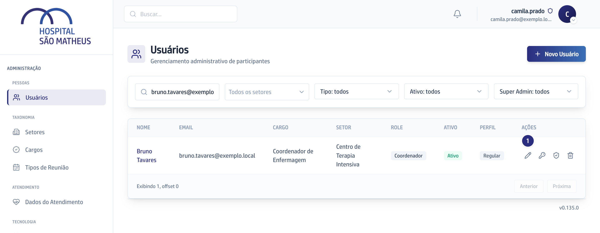
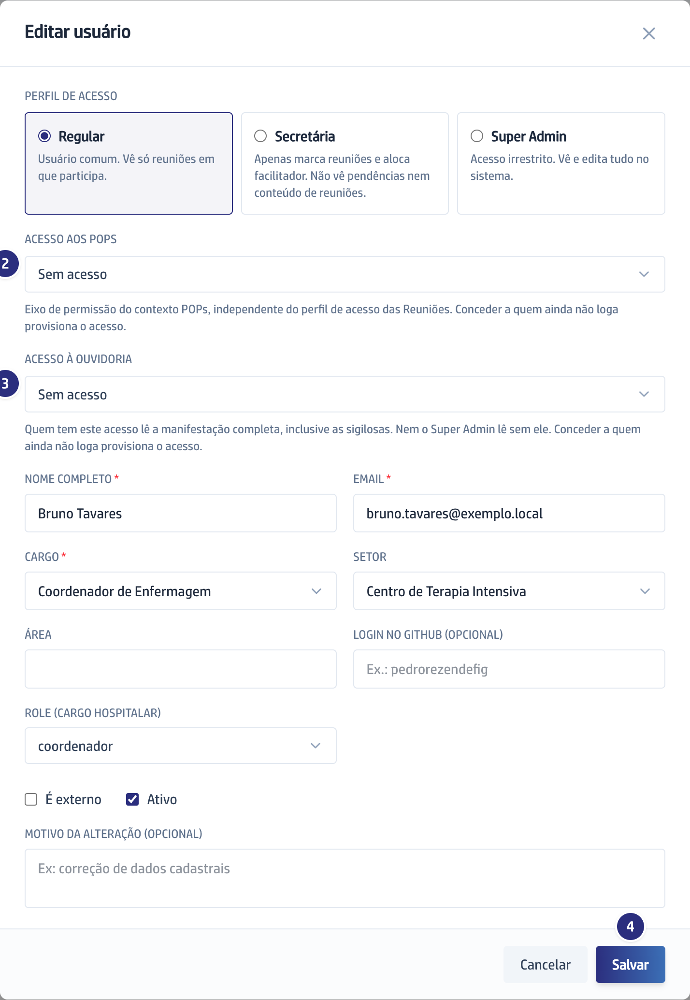

## Quando usar

Quando alguém vai cuidar de procedimentos ou manifestações. Os dois acessos
independem do Perfil de acesso, e sem eles nem o Super Admin abre os POPs ou o
caso da Ouvidoria.

O acesso aos POPs também se concede pela área de POPs:
[Dar acesso à Gestão de POPs](/pops/dar-acesso-a-gestao-de-pops/).

## Passo a passo

1. Em **Usuários**, ache a pessoa e clique no lápis, **Editar**. Os dois blocos
   só aparecem ao editar.

   

2. Em **Acesso aos POPs**, escolha **Superadmin**, **Gestor de Qualidade**,
   **Gerente** ou **Coordenador**. **Sem acesso** revoga.

   

3. Em **Acesso à Ouvidoria**, escolha **Ouvidor** ou **Diretoria Executiva**.
   **Sem acesso** revoga.
4. Escreva o **Motivo da alteração** e clique em **Salvar**.
5. Se a pessoa nunca entrou na plataforma, a senha dela aparece agora, uma vez
   só. Copie antes de fechar.
6. Quem recebeu acesso aos POPs precisa dos **Setores da pessoa** marcados na
   tela de POPs.

## Se der errado

- **A tela avisa que parte dos dados foi salva e o acesso falhou:** os três
  blocos são gravados um a um, e a lista mostra o que ficou. Repita o que
  falhou.
- **A tela recusa com "Pessoa sem email cadastrado":** o acesso cria o login, que
  precisa de endereço. Preencha o **Email** ali mesmo e salve.
- **A pessoa vê a lista da Ouvidoria mas não abre nenhum caso:** a lista é de
  toda a equipe de Reuniões, e abrir o caso exige **Ouvidor** ou
  **Diretoria Executiva**. Veja se ela ficou em **Sem acesso**.
