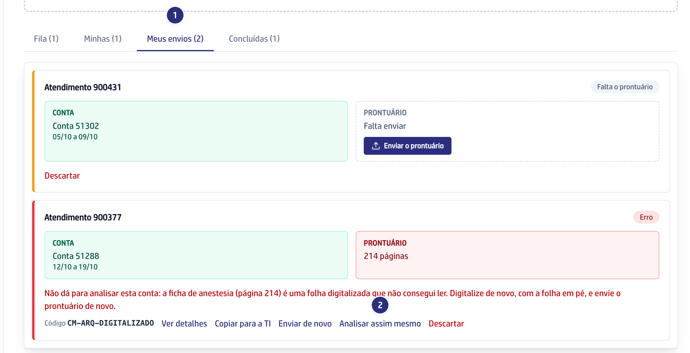
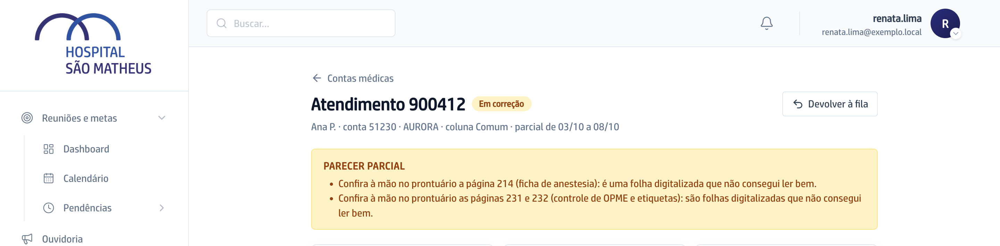

## Quando usar

Quando a conta parou em **Erro** com o código `CM-ARQ-DIGITALIZADO` e a folha
apontada no cartão não tem como ser digitalizada de novo. Se der para
digitalizar, prefira **Enviar de novo** com o prontuário refeito: o guia sai
mais completo.
Quem pode é quem enviou a conta ou a gestão de contas médicas.

## Passo a passo

1. Em **Contas médicas**, abra a aba **Meus envios**.
2. No cartão do atendimento, leia a frase: ela diz qual página não deu para
   ler. Clique em **Analisar assim mesmo**. O cartão passa para **Na fila**.

   

3. Quando a conta chegar na **Fila**, abra o guia. A faixa **PARECER PARCIAL**
   lista as páginas que não deram para ler. Confira cada uma no PDF do
   prontuário antes de marcar as linhas.

   

## Se der errado

- **O botão Analisar assim mesmo não aparece:** a conta parou por outro
  motivo, ou os PDFs já passaram dos 7 dias. Use **Enviar de novo**.
- **Aparece "Só quem enviou a conta ou a gestão pode analisar assim
  mesmo.":** peça a quem enviou ou à gestão de contas médicas.
- **A conta parou de novo no mesmo código:** chegou um prontuário novo do
  atendimento, e a escolha valia só para o anterior. Clique de novo em
  **Analisar assim mesmo**.
