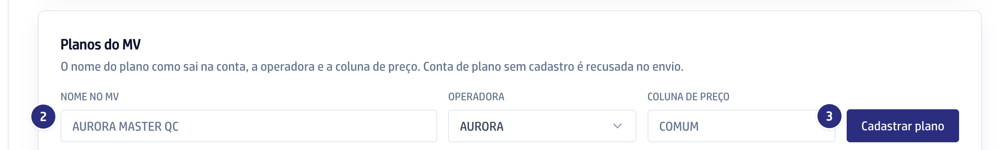
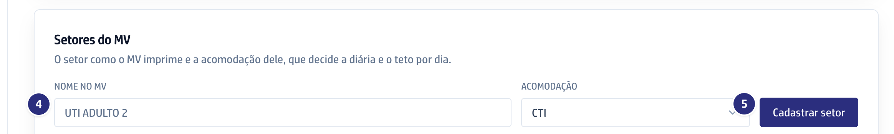

## Quando usar

Quando a faturista recebe "Plano ... ainda não configurado" ao enviar uma
conta, quando a operadora lança um plano novo ou quando o MV ganha um setor.

## Passo a passo

1. Em **Contas médicas**, clique em **Operadoras**.
2. Em **Planos do MV**, escreva o **Nome no MV** igual ao que sai na conta.
3. Escolha a **Operadora** e, se ela tem mais de uma, a **Coluna de preço**.
   Clique em **Cadastrar plano**.

   

4. Em **Setores do MV**, escreva o **Nome no MV** do setor.
5. Escolha a **Acomodação** e clique em **Cadastrar setor**. É a acomodação
   que decide a diária e o teto por dia.

   

## Se der errado

- **O botão Cadastrar plano está apagado:** falta o **Nome no MV** ou a
  **Operadora**.
- **A operadora não aparece na lista:** ela ainda não tem memória. Carregue a
  memória primeiro.
- **A conta continua recusada:** o nome não bate com o da conta. Copie o plano
  como ele sai no cabeçalho da conta.
