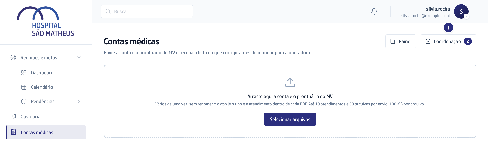
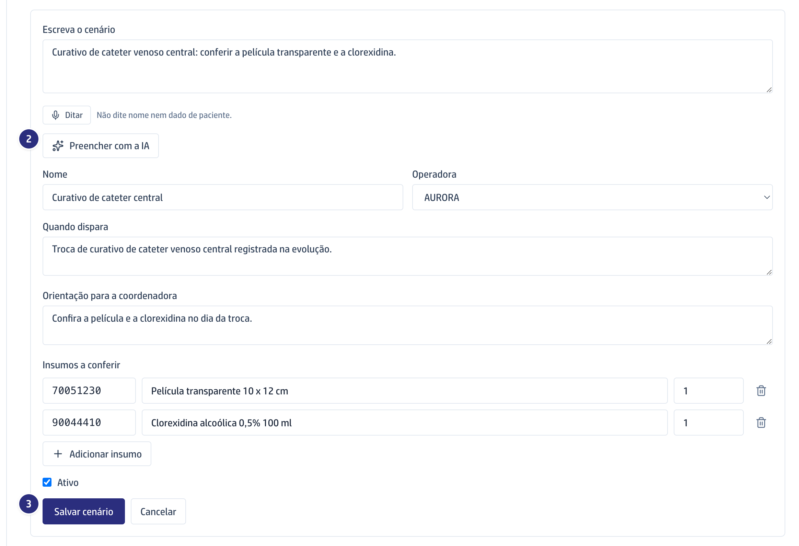
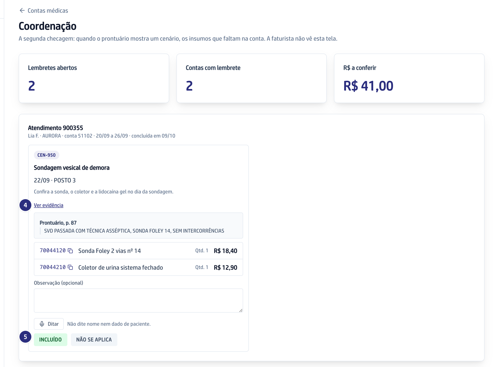

## Quando usar

Na segunda checagem das contas. A gestão cadastra o **cenário** (o procedimento
e os insumos que ele pede); quando o prontuário mostra o cenário e falta insumo
na conta, a coordenadora recebe um **lembrete**. A faturista não vê esta tela.

## Passo a passo

1. Em **Contas médicas**, clique em **Coordenação**. O número no botão é o de
   lembretes abertos.

   

2. Para cadastrar, na aba **Cenários**, clique em **Novo cenário**. Escreva o
   cenário em **Escreva o cenário** e clique em **Preencher com a IA**.
3. Confira o **Nome**, a **Operadora**, **Quando dispara**, a **Orientação para
   a coordenadora** e os **Insumos a conferir**. Clique em **Salvar cenário**.

   

4. Os lembretes vêm por conta, o mais antigo primeiro, com os insumos que
   faltam, a quantidade e o valor. Clique em **Ver evidência** para ler o
   trecho do prontuário.
5. Lance no MV e clique em **Incluído**, ou clique em **Não se aplica**. Se
   quiser, escreva antes em **Observação (opcional)**.

   

## Se der errado

- **A aba Cenários não aparece:** cadastrar cenário pede a permissão de incluir
  regra operacional. A coordenadora confere os lembretes sem ela.
- **Aparece "Código fora da tabela da operadora":** o código não está na tabela
  de preço. Confira antes de salvar.
- **Um cenário parou de valer:** clique em **Desativar** na lista. Ele para de
  gerar lembretes e pode voltar com **Ativar**.
