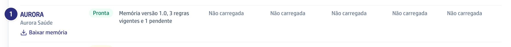

## Quando usar

Para começar a conferir as contas de uma operadora nova, quando a memória ganha
uma versão nova ou quando a operadora manda uma tabela de preço nova.

## Passo a passo

1. Em **Contas médicas**, clique em **Operadoras**, no alto à direita.

   

2. Em **Enviar memória**, escolha o **Arquivo de memória** da operadora e
   clique em **Enviar memória**. A versão nova aposenta a anterior.
3. Confira o quadro verde: a versão lida e quantas regras estão vigentes e
   pendentes.

   

4. Em **Enviar tabela de preço**, escolha a **Operadora da tabela**, a
   **Categoria**, o **Início da vigência** e o **Arquivo da tabela**, em CSV.
   Clique em **Enviar tabela**.

   

5. Na lista **Operadoras**, confira a situação e as tabelas de cada categoria.

   

## Se der errado

- **O botão Operadoras não aparece:** você não tem a permissão de regra
  contratual e tabelas. Peça à diretoria para liberar.
- **A memória foi recusada:** a mensagem diz o motivo. Arquivo com número de
  CPF é recusado sempre.
- **Uma categoria aparece Não carregada:** os itens dela saem **Não conferido**
  no guia até a tabela subir.
