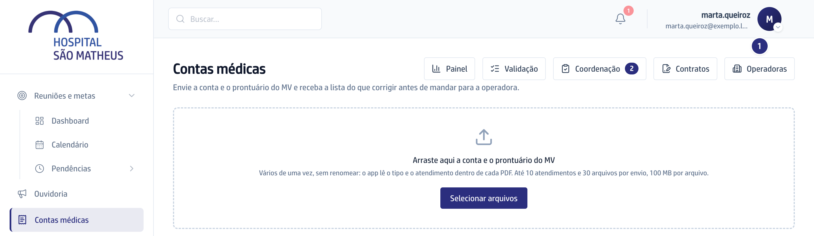
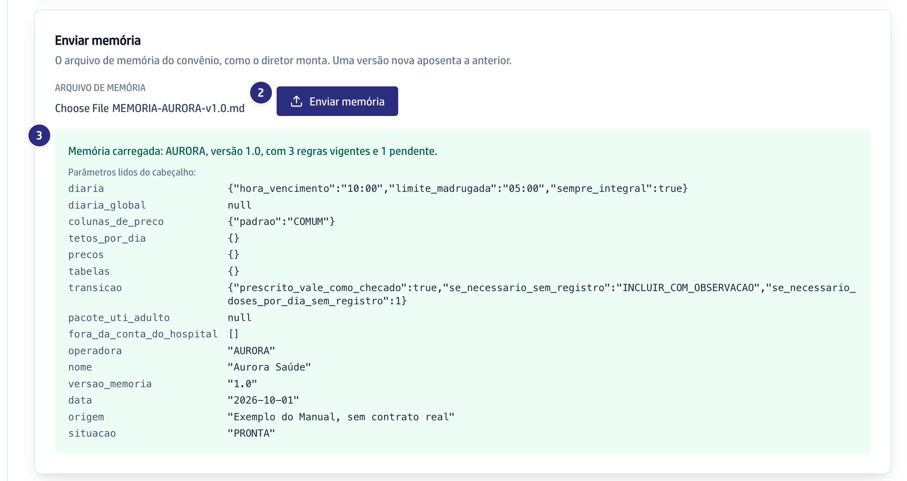
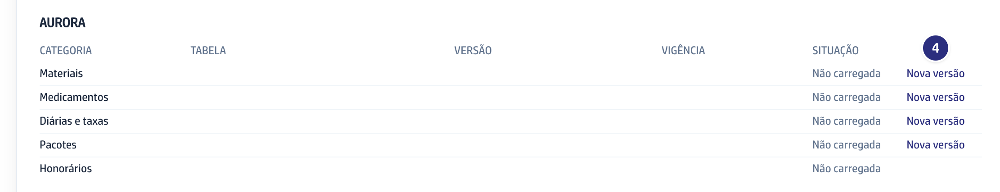
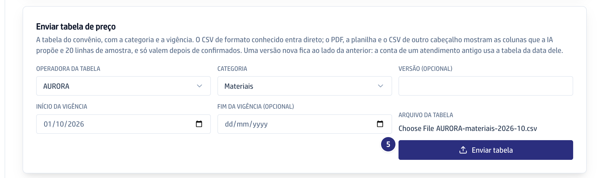
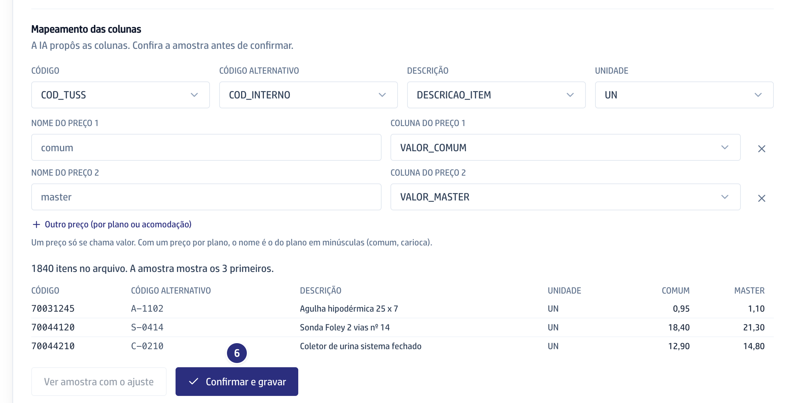

## Quando usar

Para começar a conferir as contas de uma operadora nova, quando a memória ganha
uma versão nova ou quando a operadora manda uma tabela de preço nova. Para
mudar uma regra só, não precisa subir o arquivo: veja
[Editar ou decidir uma regra da memória](../editar-ou-decidir-uma-regra-da-memoria/).

## Passo a passo

1. Em **Contas médicas**, clique em **Operadoras**, no alto à direita.

   

2. Em **Enviar memória**, escolha o **Arquivo de memória** da operadora e
   clique em **Enviar memória**. A versão nova aposenta a anterior.
3. Confira o quadro verde: a versão lida e quantas regras estão vigentes e
   pendentes.

   

4. Na **Biblioteca de tabelas**, clique em **Nova versão** na categoria. O
   envio abre com a operadora e a categoria já escolhidas.

   

5. Preencha o **Início da vigência**, escolha o **Arquivo da tabela** e clique
   em **Enviar tabela**. A versão anterior fica guardada para as
   contas antigas.

   

6. Planilha, PDF ou CSV de outro cabeçalho mostram as colunas que a IA propôs e
   a amostra. Ajustou uma coluna? Clique em **Ver amostra com o ajuste**. Por
   fim, clique em **Confirmar e gravar**.

   

## Se der errado

- **O botão Operadoras não aparece:** você não tem a permissão de regra
  contratual e tabelas. Peça à diretoria para liberar.
- **A memória foi recusada:** a mensagem diz o motivo. Arquivo com número de
  CPF é recusado sempre.
- **O Confirmar e gravar está apagado:** você mudou uma coluna. Clique em
  **Ver amostra com o ajuste** antes.
