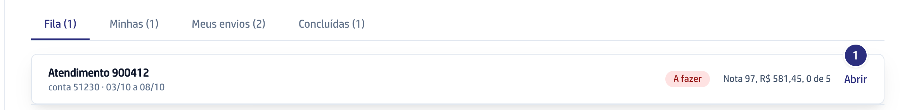
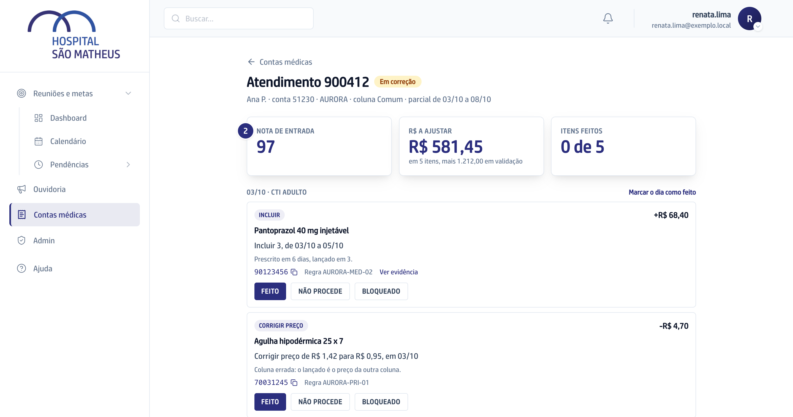
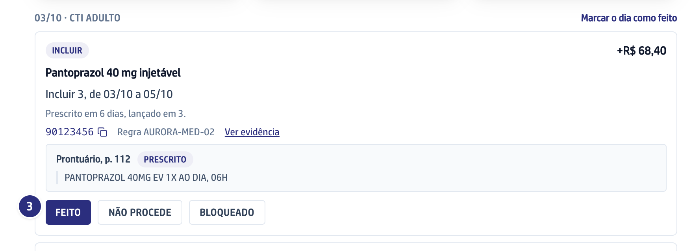
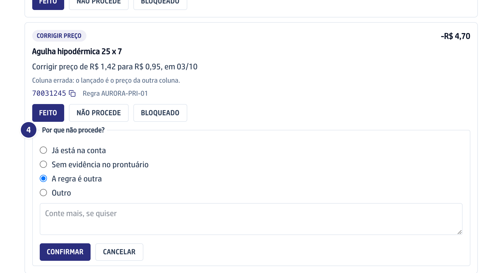
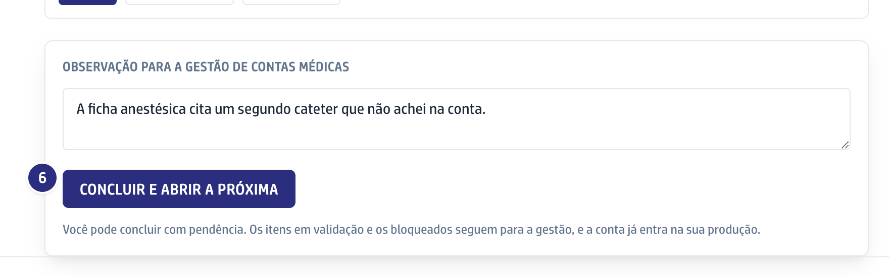
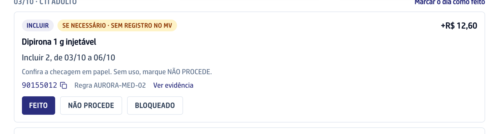

## Quando usar

Quando há conta **A fazer** na **Fila**. A Fila é a mesma para todas as
faturistas, na ordem de envio. Deixe o guia aberto ao lado do MV: ele cabe em
meia tela.

## Passo a passo

1. Na **Fila**, clique em **Abrir** na primeira conta. Ela passa a ser sua e
   vai para **Minhas**, onde **Continuar** reabre o guia.

   

2. Leia o topo: **Nota de entrada**, **R$ a ajustar** e **Itens feitos**.
   Abaixo vêm as linhas, por dia e setor.

   

3. Clique no código da linha para copiar, corrija no MV e clique em **Feito**.
   Para conferir a origem, clique em **Ver evidência**.

   

4. A correção não cabe? Clique em **Não procede**, escolha o motivo e clique em
   **Confirmar**. Se o MV não deixou lançar, clique em **Bloqueado**. Errou a
   marcação? Clique em **Desfazer**.

   

5. A linha **Validar** não tem botão, porque o item já foi para a gestão decidir.
6. Clique em **Concluir e abrir a próxima**. A primeira conta livre da Fila
   abre e passa a ser sua. A **Observação para a gestão de contas médicas**
   vai junto.

   

## Quando a linha pede conferência

- **SE NECESSÁRIO · SEM REGISTRO NO MV**: confira a checagem em papel; sem
  uso, marque **Não procede**.

  

- **conferir evidência** ou **Conferir classe de UTI**: confira o prontuário
  antes.

## Se der errado

- **Aparece "Outra faturista já pegou esta conta":** ela abriu antes. Volte em
  **Contas médicas** e abra a próxima da Fila.
- **Aparece "itens sem marcação. Concluir assim mesmo?":** ainda há linha
  aberta. Confirme para concluir com pendência, ou volte e marque.
- **O botão Confirmar está apagado:** falta o motivo. Em **Outro**, escrever o
  texto é obrigatório.
