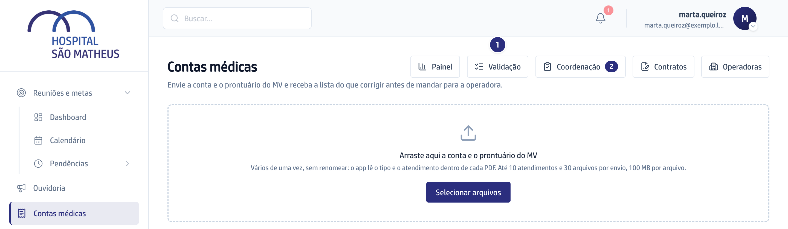
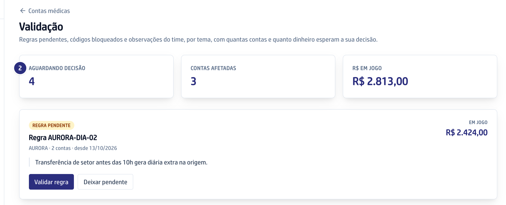
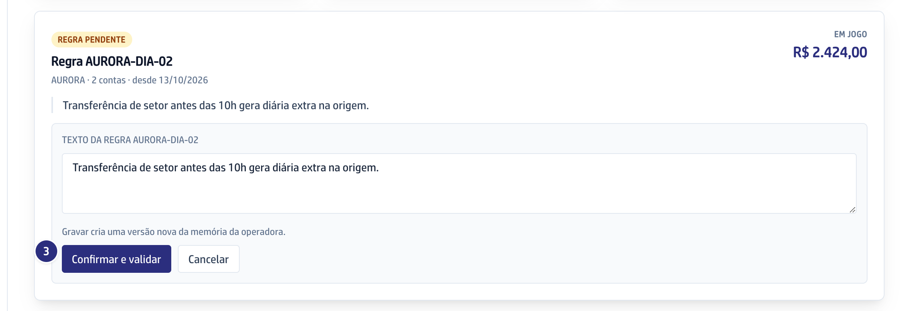
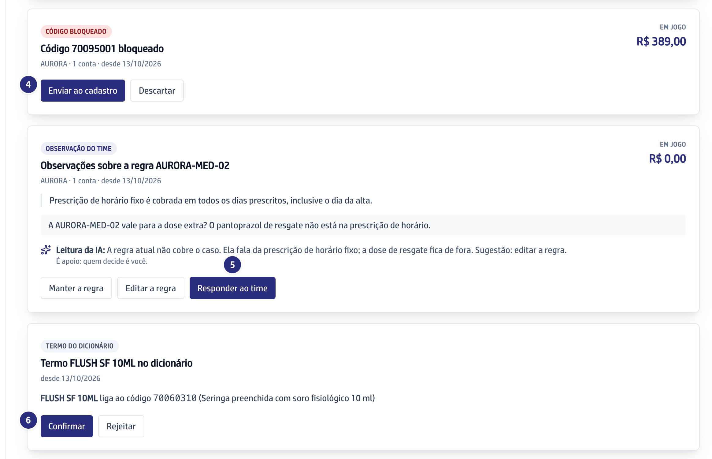

## Quando usar

Quando há linhas **Validar** nos guias, códigos **Bloqueado** ou observações
da faturista. A fila junta tudo por tema: uma decisão vale para todas as contas
do tema.

## Passo a passo

1. Em **Contas médicas**, clique em **Validação**.

   

2. Leia o topo: **Aguardando decisão**, **Contas afetadas** e **R$ em jogo**.
   Os cartões vêm do maior valor para o menor.

   

:::caution[Não tem volta]
A decisão fecha o tema e ele sai da fila. Validar a regra cria uma versão nova
da memória e devolve as linhas às contas.
:::

3. **Regra pendente:** clique em **Validar regra**, confira o texto e clique em
   **Confirmar e validar**. Para decidir depois, **Deixar pendente**.

   

4. **Código bloqueado:** **Enviar ao cadastro** baixa a lista para o cadastro
   do MV; **Descartar** fecha sem ação.
5. **Observação do time:** leia a **Leitura da IA** e escolha **Manter a
   regra**, **Editar a regra** ou **Responder ao time**. A faturista vê a
   resposta no guia da conta.
6. **Termo do dicionário:** clique em **Confirmar** ou **Rejeitar**.

   

## Se der errado

- **O botão Validação não aparece:** falta a permissão de decidir na
  validação. Peça à diretoria.
- **Aparece "Este tema já foi decidido":** outra pessoa decidiu antes.
  Recarregue a tela para ver o que sobrou.
- **A leitura da IA não veio:** decida sem ela. A leitura é apoio; quem decide
  é você.
