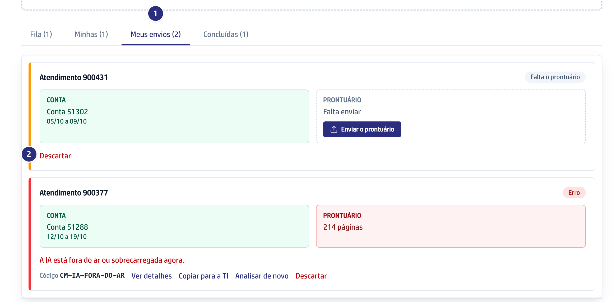

## Quando usar

Quando a conta parada em **Meus envios** perdeu o sentido, porque você mandou
o atendimento errado ou a conta foi refeita no MV. Só a conta em **Erro** ou
que espera um arquivo pode ser descartada.
Quem descarta é quem enviou ou a gestão de contas médicas, que vê a aba como
**Envios**.

## Passo a passo

1. Em **Contas médicas**, abra a aba **Meus envios**.
2. No cartão do atendimento, clique em **Descartar**.

   

:::caution[Não tem volta]
A conta e os PDFs saem do sistema na hora. Para analisar esse atendimento
depois, envie a conta e o prontuário de novo.
:::

3. Confirme na janela que pergunta "Descartar o atendimento ...? Os arquivos
   serão apagados." O cartão sai da lista.

## Se der errado

- **O botão Descartar não aparece:** a conta já foi para a análise ou tem
  guia. Se mais de uma pessoa enviou o prontuário do atendimento, só a gestão
  descarta.
- **Aparece "Só quem enviou a conta ou a gestão pode descartar.":** peça a
  quem enviou ou à gestão de contas médicas.
- **Aparece "A conta já tem Guia e não pode ser descartada.":** a análise
  terminou antes do seu clique. A conta está na **Fila**.
