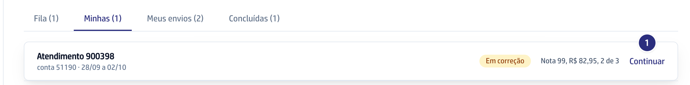
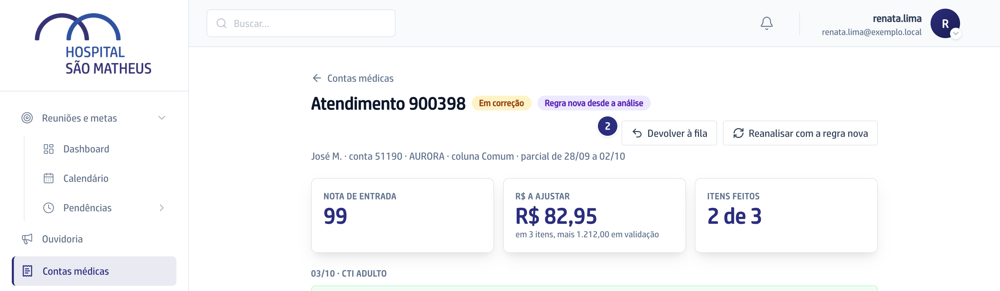

## Quando usar

Quando você abriu uma conta e não vai terminar, por exemplo porque vai sair
mais cedo. A conta volta para a **Fila** e o que você já
marcou fica nela. A coordenação devolve do mesmo jeito a conta de quem faltou,
pela aba **Em análise**.

## Passo a passo

1. Em **Contas médicas**, abra a aba **Minhas** e clique em **Continuar** na
   conta.

   

2. No topo do guia, clique em **Devolver à fila**.

   

3. Na pergunta "Devolver esta conta à fila? As marcações ficam na conta para
   quem pegar depois.", clique em **OK**. A conta volta como **A fazer**, no
   mesmo lugar da Fila, e sai de **Minhas**.

## Se der errado

- **O botão Devolver à fila não aparece:** só a conta **Em correção** volta.
  A conta em **Retorno** fica com você, e a concluída não volta.
- **Aparece "Só a conta Em correção volta para a Fila":** a conta foi
  concluída antes, em outra janela. Ela fica em **Concluídas**.
- **A conta não está em Minhas:** ela é de outra faturista. Peça à
  coordenação para devolver.
