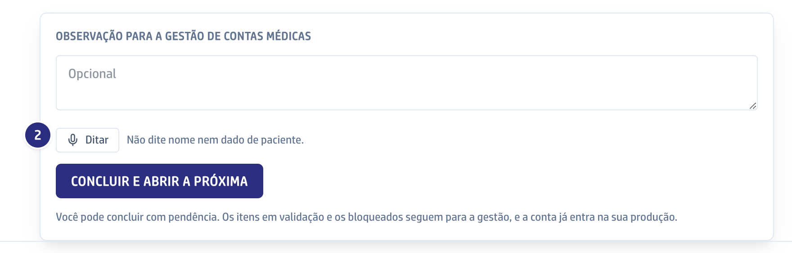

## Quando usar

Nos seis campos de texto longo do módulo: a **Observação para a gestão de
contas médicas** e o motivo do **Não procede**, no guia; a regra em **Ensinar
uma regra nova**; a resposta de **Responder ao time**, na Validação; e o cenário e a
observação do lembrete, na Coordenação.

## Passo a passo

1. Abra a tela com o campo. O botão **Ditar** fica logo abaixo dele.
2. Clique em **Ditar** e fale. O navegador pede o microfone na primeira vez:
   permita. Enquanto você fala, o botão vira **Parar**.

   

3. Clique em **Parar**. O botão mostra **Transcrevendo** e, em seguida, o texto
   cai no campo, depois do que você já tinha escrito.
4. Revise o texto. O ditado só preenche o campo; para enviar, use o botão do
   formulário.

## Se der errado

- **O botão não grava:** o microfone está bloqueado no navegador. Libere nas
  permissões do site e tente de novo.
- **O texto saiu errado:** corrija no próprio campo, como em qualquer texto.
- **Precisou citar a paciente:** não dite nome nem dado de paciente. O áudio
  vai para um serviço de transcrição fora do hospital.
