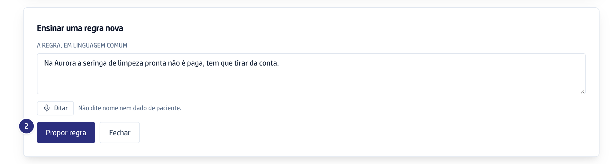
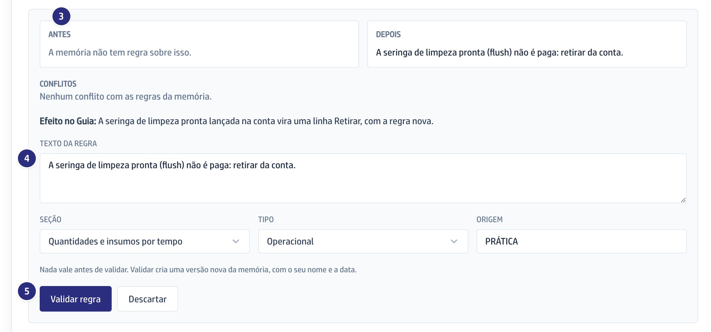
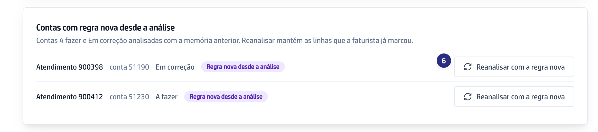

## Quando usar

Quando a operadora tem uma regra que a memória ainda não conhece. Você escreve
em linguagem comum e a IA monta a regra; nada vale antes de você validar.

## Passo a passo

1. Em **Operadoras**, clique na sigla da operadora e, na Memória da operadora,
   clique em **Ensinar uma regra nova**.

   

2. Escreva a regra em **A regra, em linguagem comum**, ou clique em **Ditar**
   e fale. Clique em **Propor regra**.

   

3. Confira a proposta: **Antes**, **Depois**, os **Conflitos** com as regras
   que já existem e o **Efeito no Guia**.
4. Ajuste o **Texto da regra**, a **Seção**, o **Tipo** e a **Origem**, se
   precisar.
5. Clique em **Validar regra**. A memória ganha uma versão nova, com o seu
   nome e a data. Para desistir, clique em **Descartar**.

   

6. Em **Contas com regra nova desde a análise**, clique em **Reanalisar com a
   regra nova** na conta que deve seguir a regra. As linhas que a faturista já
   marcou ficam como estão.

   

## Se der errado

- **A proposta aponta conflito:** a memória já tem regra sobre o assunto.
  Edite a regra antiga em vez de criar outra.
- **O botão Reanalisar não aparece:** ele é de quem tem a permissão de regra
  contratual e tabelas.
- **A conta não está na lista:** só entram contas **A fazer** e **Em
  correção**. Conta concluída não muda.
