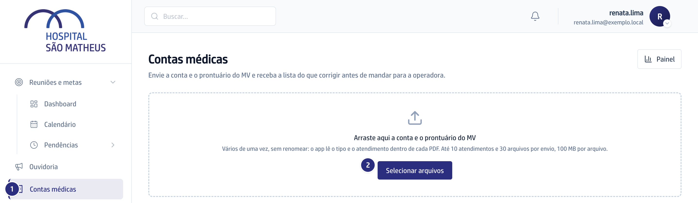
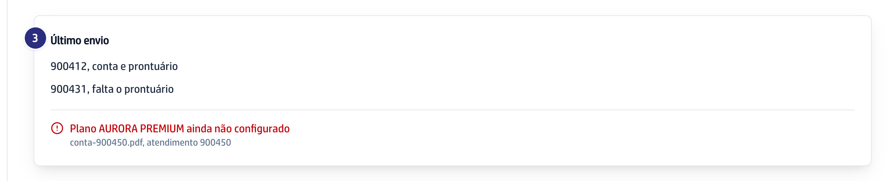
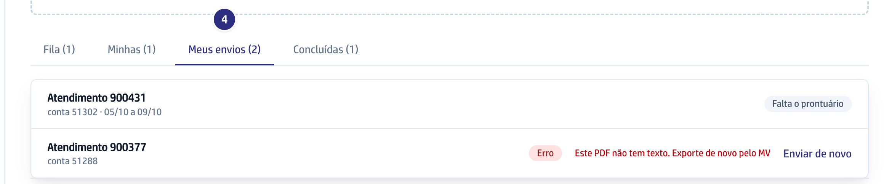

## Quando usar

Antes de mandar a conta de internação para a operadora. Exporte do MV a conta
("Fatura Individual") e o prontuário completo do mesmo atendimento, em PDF.
A conta que você envia entra na **Fila**, e a faturista que abrir primeiro
corrige.

## Passo a passo

1. No menu da esquerda, clique em **Contas médicas**.
2. Arraste os PDFs para a área tracejada, ou clique em **Selecionar arquivos**.
   Pode mandar vários atendimentos de uma vez, sem renomear nada: até 10
   atendimentos e 30 arquivos por envio, 100 MB por arquivo.

   

3. Confira o **Último envio**: uma linha por atendimento, dizendo se chegaram
   a conta e o prontuário ou se falta um deles.

   

4. Acompanhe em **Meus envios** as contas que você mandou e que ainda não
   ficaram prontas. Quando o guia fica pronto, a conta sai daí e entra na
   **Fila**, e o sino avisa.

   

5. Faltou um arquivo? Mande só o que falta: o sistema junta pelo atendimento.

## Se der errado

- **Aparece "Plano ... ainda não configurado":** o plano da conta não está
  cadastrado. Peça à gestão de contas médicas para cadastrar e envie de novo.
- **A conta ficou em Erro:** o motivo aparece ao lado. Exporte de novo pelo MV
  e clique em **Enviar de novo**.
- **Aparece "Não reconheci o arquivo":** o PDF não é a conta nem o prontuário
  do MV. Confira se exportou o arquivo certo.
