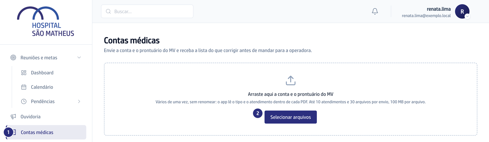
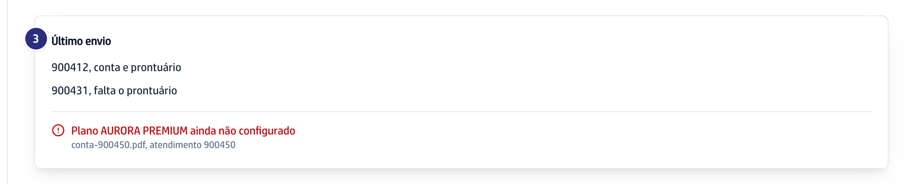
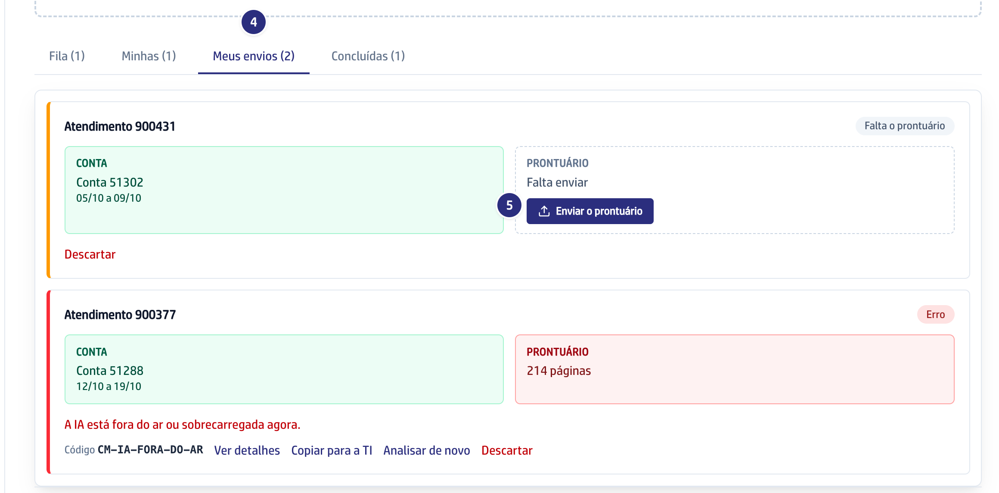

## Quando usar

Antes de mandar a conta de internação para a operadora. Exporte do MV a conta
("Fatura Individual") e o prontuário completo do mesmo atendimento, em PDF.

## Passo a passo

1. No menu da esquerda, clique em **Contas médicas**.
2. Arraste os PDFs para a área tracejada, ou clique em **Selecionar arquivos**.
   Pode mandar vários atendimentos de uma vez, sem renomear nada: até 10
   atendimentos e 30 arquivos por envio, 100 MB por arquivo.

   

3. Confira o **Último envio**: uma linha por atendimento, dizendo se chegaram
   a conta e o prontuário ou se falta um deles.

   

4. Acompanhe em **Meus envios** o que ainda não ficou pronto. Cada conta tem
   um quadrado para a **Conta** e outro para o **Prontuário**, vermelho onde a
   análise parou. Com o guia pronto, a conta vai para a **Fila** das
   faturistas.
5. Faltou um arquivo? Clique em **Enviar o prontuário** ou **Enviar a conta** e
   escolha o PDF.

   

## Se der errado

- **A conta ficou em Erro:** clique em **Analisar de novo**, ou exporte o PDF
  pelo MV e clique em **Enviar de novo**. **Copiar para a TI** leva o erro para
  a TI. Veja [Quando a conta dá erro](../como-funciona/quando-a-conta-da-erro/).
- **Aparece "Plano ... ainda não configurado":** o plano da conta não está
  cadastrado. Peça à gestão de contas médicas para cadastrar e envie de novo.
- **Aparece "Não reconheci o arquivo":** o PDF não é a conta nem o prontuário
  do MV. Confira se exportou o arquivo certo.
