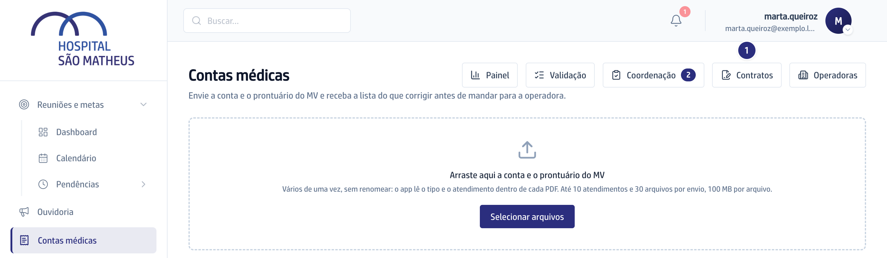
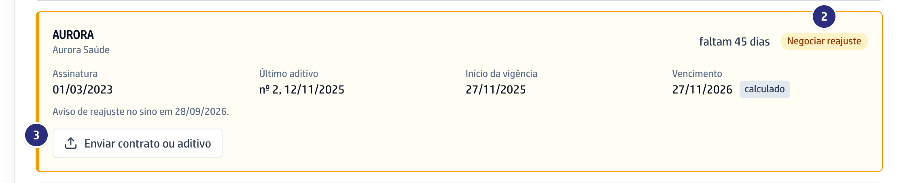
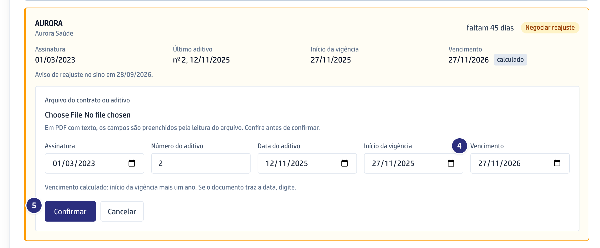

## Quando usar

Para saber quando começar a negociar o reajuste com cada operadora e para
registrar o contrato ou o aditivo novo. O credenciamento acompanha a tela e
recebe o aviso; quem envia o documento é a gestão.

## Passo a passo

1. Em **Contas médicas**, clique em **Contratos**.

   

2. Confira cada operadora: os dias que faltam e a situação, **Em dia**,
   **Negociar reajuste**, **Vencido** ou **Sem contrato**.
3. Para atualizar, clique em **Enviar contrato ou aditivo** e escolha o
   **Arquivo do contrato ou aditivo**. Em PDF com texto, os campos já vêm
   preenchidos.

   

4. Confira **Assinatura**, **Número do aditivo**, **Data do aditivo**,
   **Início da vigência** e **Vencimento**. Se o documento não traz o
   vencimento, ele é o início da vigência mais um ano.
5. Clique em **Confirmar**. Nada muda antes disso.

   

6. Na data do aviso, quem acompanha os contratos recebe no sino o lembrete de
   reajuste da operadora.

## Se der errado

- **O botão Enviar contrato ou aditivo não aparece:** você vê os contratos e
  recebe o aviso, mas quem muda o contrato é a gestão.
- **O vencimento aparece com a etiqueta calculado:** o documento não trouxe a
  data. Se ela existir, digite em **Vencimento** e confirme.
- **A operadora está Sem contrato:** a memória dela não traz o contrato.
  Envie o contrato pela tela.
