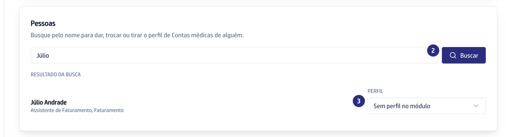
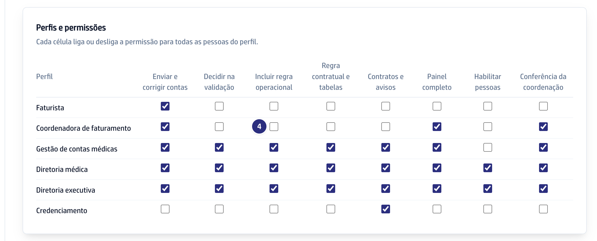

## Quando usar

Quando alguém começa ou deixa de trabalhar com as contas, ou quando um perfil
inteiro precisa ganhar ou perder uma permissão. A mudança vale na hora, sem
pedir nada à equipe de tecnologia, e fica registrada com o seu nome e a data.

## Passo a passo

1. Em **Contas médicas**, clique em **Habilitação**.

   

2. Em **Pessoas**, escreva o nome e clique em **Buscar**.
3. No campo **Perfil** da pessoa, escolha o perfil: **Faturista**,
   **Coordenadora de faturamento**, **Gestão de contas médicas**, **Diretoria
   médica**, **Diretoria executiva** ou **Credenciamento**. Para tirar, escolha
   **Sem perfil no módulo**.

   

4. Para mudar o que um perfil faz, em **Perfis e permissões**, marque ou
   desmarque a célula. Vale para todas as pessoas do perfil.

   

## Se der errado

- **O botão Habilitação não aparece:** só quem tem a permissão de habilitar
  pessoas vê, em geral a diretoria.
- **Aparece "Ninguém encontrado com esse nome.":** a pessoa ainda não tem
  cadastro na plataforma. Peça o acesso ao administrador.
- **A pessoa não vê a tela nova:** peça que ela recarregue a página.
