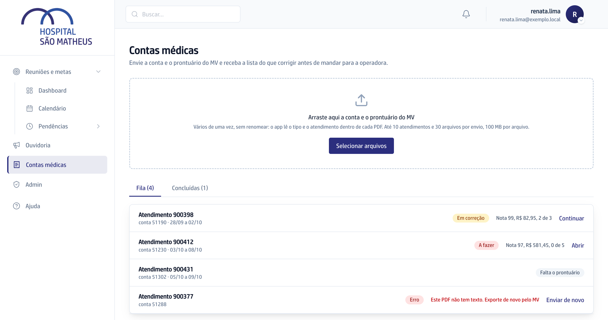

Esta seção cobre **Contas médicas**: você envia a conta e o prontuário que já
exporta do MV e recebe, em minutos, a lista do que corrigir na conta antes de
mandar para a operadora.

## As palavras que você vai ver o tempo todo

**Atendimento** é o número da internação no MV. O sistema lê esse número
dentro dos PDFs e junta a conta e o prontuário por ele; você nunca digita.

**Conta** é a fatura do atendimento, o PDF "Fatura Individual" do MV. Quando a
internação é cobrada em partes, cada **parcial** vira uma conta na fila.

**Operadora** é o convênio (ASSIM, Unimed e as outras). O sistema descobre a
operadora pelo plano impresso na conta.

**Memória** é o conjunto de regras de cada operadora: preço, diária, o que entra
em pacote. Cada conta é conferida só contra a memória da operadora dela.

**Guia** é a lista do que corrigir numa conta, agrupada por dia e setor. Cada
linha começa pelo verbo: **Incluir**, **Ajustar quantidade**, **Retirar**,
**Corrigir preço** ou **Validar**.

## Quem faz o quê

- **Faturista** envia as contas e corrige cada uma pelo guia. Vê só as contas
  que ela mesma enviou.
- **Coordenadora de faturamento** faz a segunda checagem das contas pelos
  lembretes da **Coordenação**.
- **Gestão de contas médicas** e **Diretoria** carregam e editam a memória e as
  tabelas de cada operadora, cadastram os planos e os setores do MV e decidem
  na **Validação**.
- **Credenciamento** acompanha os **Contratos** e recebe o aviso de reajuste.
- A **Diretoria** decide quem tem cada perfil, na **Habilitação**.
- **Coordenadora de faturamento**, **Gestão de contas médicas** e **Diretoria**
  leem o **Painel**: a nota da semana e onde a perda da conta nasce.

## A tela que reúne tudo

Em **Contas médicas**, no menu da esquerda, fica a área de envio, a **Fila** com
as contas na ordem em que chegaram e a aba **Concluídas**. No alto, cada pessoa
vê os botões do perfil dela: **Painel**, **Validação**, **Coordenação**,
**Contratos**, **Operadoras** e **Habilitação**.

## O caminho de ponta a ponta

1. Você arrasta a conta e o prontuário do MV para a tela. O sistema junta os
   dois pelo atendimento e a conta entra na fila.
2. O sistema lê os dois PDFs e conta as diárias, a inteligência artificial lê
   o texto livre do prontuário, e tudo é conferido contra a memória da
   operadora. A conta fica **A fazer** e o sino avisa.
3. Você abre o guia, corrige no MV linha a linha e marca **Feito**, **Não
   procede** ou **Bloqueado**.
4. Você clica em **Concluir e abrir a próxima**, e a conta vai para
   **Concluídas**.
5. Se quiser, você reenvia só a conta corrigida e vê se cada correção pegou,
   com a **Nota de saída**.

O que você marca fica guardado e mostra onde a conta costuma sair errada.
