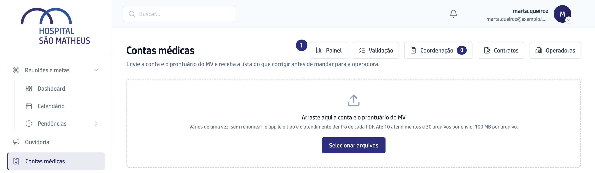
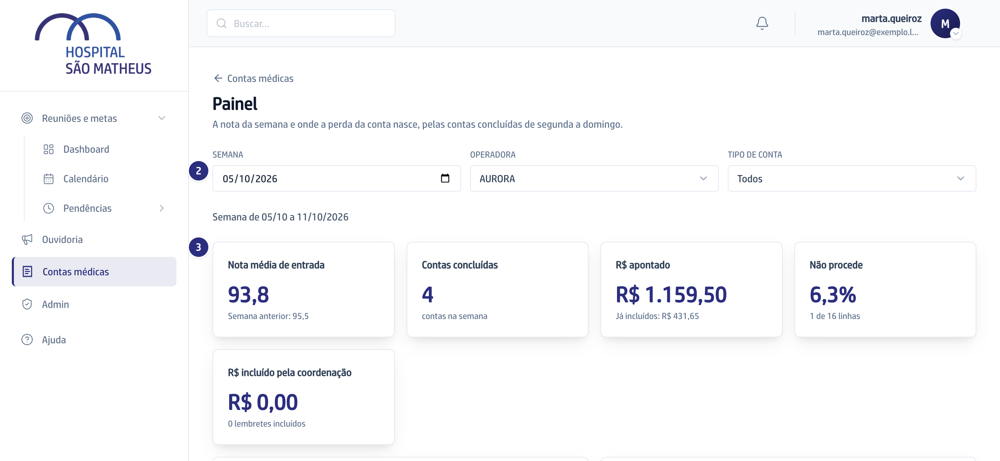
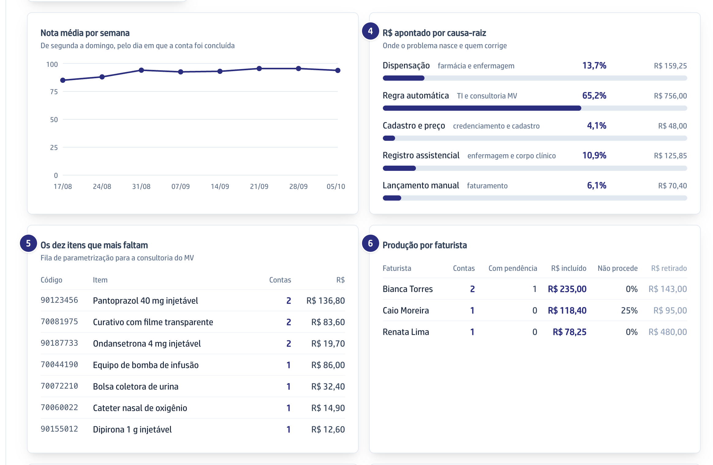

## Quando usar

Uma vez por semana, para ver se as contas estão saindo mais certas do MV e
quem precisa corrigir o quê. Os números são das contas concluídas de segunda a
domingo, pelo dia em que a faturista concluiu.

## Passo a passo

1. Em **Contas médicas**, clique em **Painel**.

   

2. Escolha a **Semana** (qualquer dia dela serve), a **Operadora** e o **Tipo
   de conta**. Os números mudam na hora.
3. Leia os cartões do topo: **Nota média de entrada**, com a semana anterior
   ao lado, **Contas concluídas**, **R$ apontado** e **Não procede**.

   

4. Em **R$ apontado por causa-raiz**, veja onde a perda nasce e quem corrige:
   a farmácia, o cadastro, a enfermagem ou o próprio faturamento.
5. Leve **Os dez itens que mais faltam** para a consultoria do MV: são os
   itens que o MV deveria lançar sozinho.
6. Em **Produção por faturista**, compare contas e valor lado a lado.

   

## Se der errado

- **A faturista diz que só vê uma linha:** é assim. Ela vê só a própria
  produção, e mais nenhum bloco.
- **A semana aparece vazia:** nenhuma conta foi concluída nela. A conta conta
  na semana em que foi concluída, não na do envio.
- **O botão Painel não aparece:** o seu perfil não tem o Painel. Peça à
  diretoria pela tela de Habilitação.
