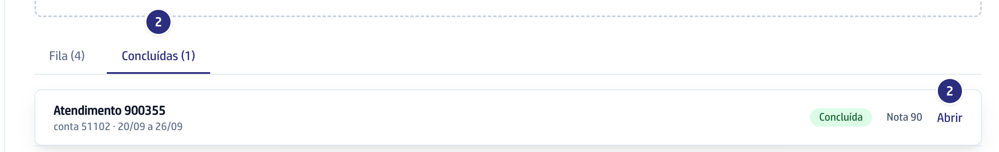
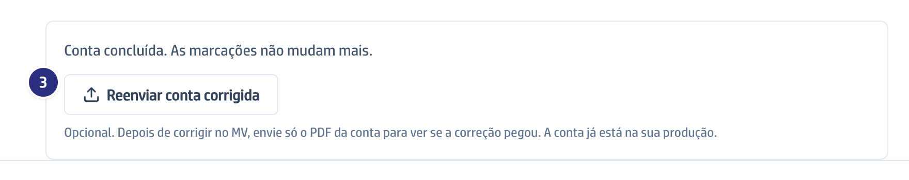
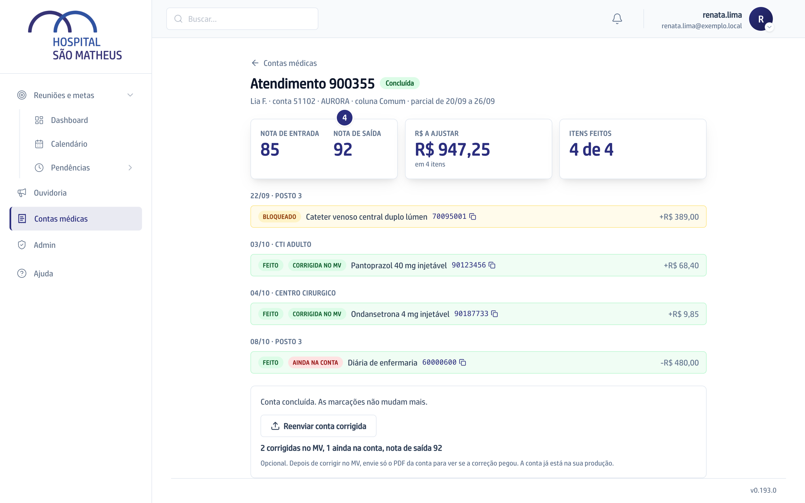

## Quando usar

Depois de concluir o guia e corrigir a conta no MV, quando quiser conferir se
cada correção entrou mesmo. É opcional: a conta concluída já está na sua
produção, com ou sem reenvio.

## Passo a passo

1. Exporte de novo do MV só a conta corrigida ("Fatura Individual"), em PDF.
   O prontuário não precisa ir.
2. Em **Contas médicas**, abra a aba **Concluídas** e clique em **Abrir** na
   conta.

   

3. No rodapé do guia, clique em **Reenviar conta corrigida** e escolha o PDF.

   

4. Leia o resultado. Cada linha **Feito** ganha **corrigida no MV** ou **ainda
   na conta**, e a **Nota de saída** aparece ao lado da **Nota de entrada**.

   

5. Tem várias contas para reenviar? Arraste todas para a área de envio da tela
   **Contas médicas**. O **Último envio** mostra cada uma como reenvio, e a
   conta continua em **Concluídas**.

## Se der errado

- **Aparece "Este PDF é de outra conta":** o arquivo é de outro atendimento ou
  de outra conta. Exporte a conta com o número que a mensagem cita.
- **Aparece "Este PDF não é a conta do MV":** você escolheu o prontuário ou
  outro arquivo. Envie só a conta.
- **A linha ficou "ainda na conta", mas você corrigiu:** exporte de novo
  depois de salvar a correção no MV e reenvie.
