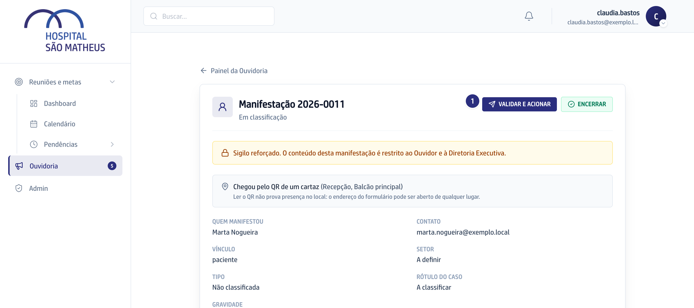
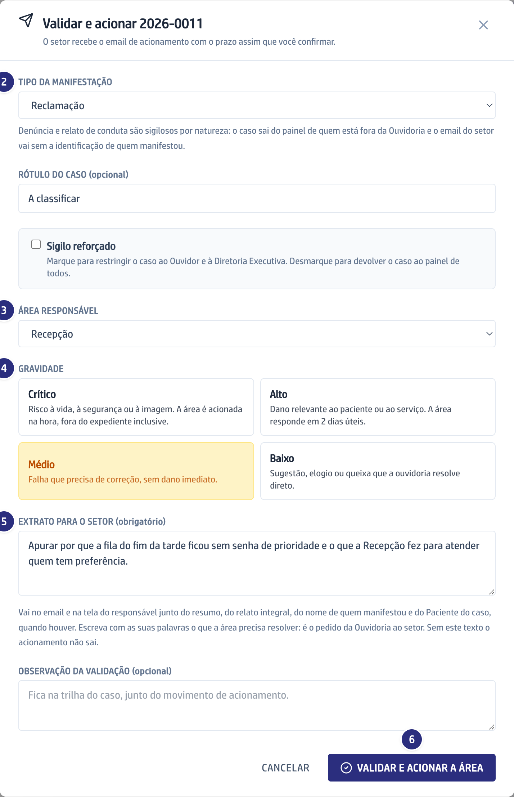

## Quando usar

Assim que um caso novo aparece na lista. Sem este passo, nenhuma área
trabalha.

## Passo a passo

1. Abra o caso, leia o relato inteiro e clique em **Validar e acionar**. Se
   aparecer o aviso de paciente sem nome, confirme o nome com quem manifestou.

   

2. Escolha o **Tipo da manifestação**, que decide se o caso nasce sigiloso. Sem
   tipo, ele chega com **Sigilo reforçado** marcado; numa reclamação comum,
   desmarque.

   

3. Escolha a **Área responsável**. Setor sem titular vigente sobe ao gestor;
   sem nenhum dos dois, a tela recusa.
4. Escolha a **Gravidade**, que define o prazo da área.
5. Escreva o **Extrato para o setor**, com o que a área precisa resolver.
6. Clique em **Validar e acionar a área**. O prazo congela e o responsável
   recebe o email na hora.

## Se der errado

- **O acionamento não sai:** falta o **Extrato para o setor**. No caso sigiloso,
  ele é tudo o que o setor recebe.
- **Nada veio preenchido pela Ana nem pelo que a pessoa marcou:** o palpite
  dos dois fica à parte e nunca vira classificação.
- **A caixa de sigilo reforçado não desmarca:** o tipo escolhido, como a
  denúncia, é sigiloso por natureza.
- **Desmarcar o sigilo mostra o caso ao hospital:** quem tem papel nas Reuniões
  vê o caso na lista, sem o resumo. Veja
  [O que é sigiloso](/ouvidoria/como-funciona/o-que-e-sigiloso/).
