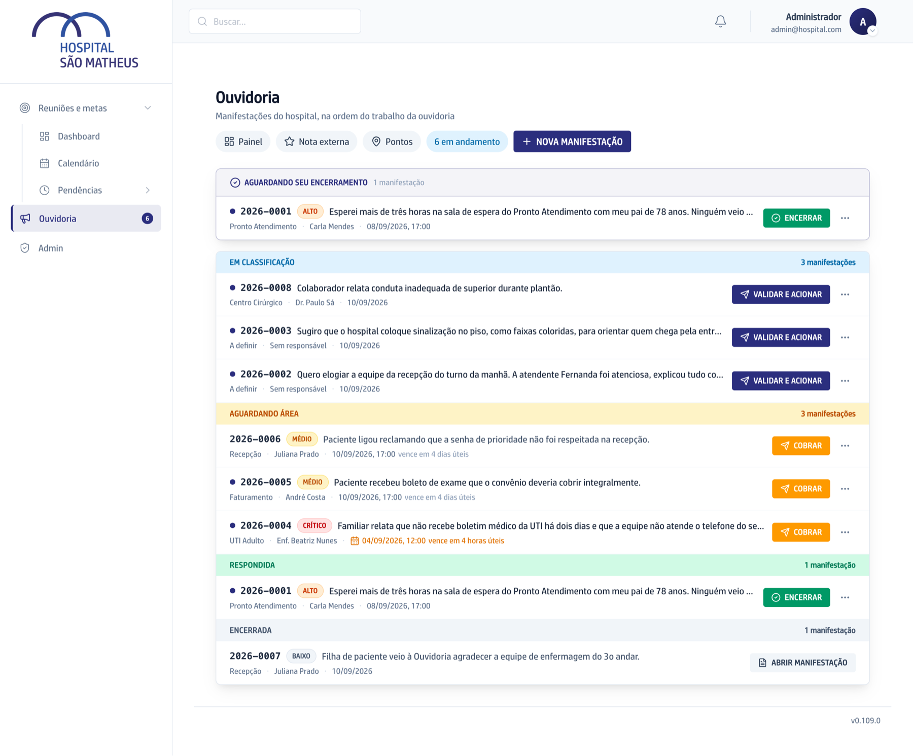
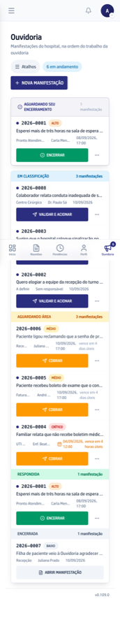

A lista é a tela principal da Ouvidoria e segue a ordem do trabalho do dia.
Primeiro vem **Aguardando seu encerramento**, com o que já foi respondido e
espera você; depois, os casos por situação, de **Nova** até **Encerrada**.

## Três informações, três lugares fixos

Cada linha tem dois andares. Em cima, o que identifica o caso: número, gravidade
e o começo do relato. Embaixo, quem cuida e até quando: setor, responsável e
vencimento. À direita fica a ação que faz sentido naquele momento.

A situação fica na faixa colorida do bloco, a gravidade na etiqueta redonda e o
prazo na cor da data. Cada uma tem sempre o mesmo lugar, sem se misturar com as
outras.

## A cor da data é só sobre tempo

Vermelho para o que venceu ou vence hoje, com os carimbos **Estourado** e
**Vence hoje**. Âmbar para o que tem menos de um dia útil de folga. Cinza para o
resto.

## O ponto de novidade é do caso, não da pessoa

Ele quer dizer "a Ouvidoria ainda não viu este caso", e o contador ao lado do
menu soma esses pontos. Abrir o caso, validar ou encerrar apaga o ponto para
todo mundo. Uma pausa, uma devolução ou a resposta do setor acendem o ponto de
novo, porque trazem algo que a Ouvidoria ainda precisa ver.

No celular a linha se empilha e os botões ficam grandes o bastante para o dedo.
A Ouvidoria aparece na barra de baixo para quem tem acesso a ela.

## O que aparece para quem não é da Ouvidoria

Quem tem papel nas Reuniões e não tem acesso à Ouvidoria também abre esta lista.
De cada caso fora do sigilo, essa pessoa lê o protocolo, o setor, a situação, o
prazo, a gravidade, o tipo e, depois do encerramento, o desfecho.

Ficam fora do alcance dela o resumo, o relato de quem falou, o nome e o contato
dele, os anexos, a resposta da área e o histórico. A página do caso também não
abre para ela.

Caso sigiloso não aparece nesta lista, nem para quem administra a plataforma.
Só o sigilo decide isso, qualquer que seja a situação do caso. Um caso **Em
classificação** que não seja sigiloso aparece na lista de todo mundo.

O sigilo, por sua vez, depende da porta de entrada. O caso que chega pelo
formulário, pelo QR ou pela Ana nasce protegido, porque entra sem tipo, e sai da
proteção quando você classifica. O caso que a Ouvidoria registra à mão nasce com
o tipo que você escolheu. Se não for denúncia nem relato de conduta, ele aparece
para o hospital no instante em que você clica em **Registrar manifestação**.
