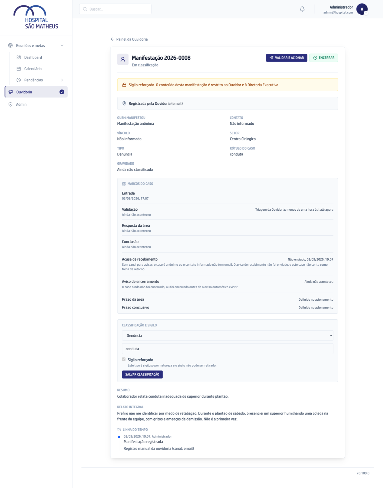

Denúncia e relato de conduta nascem sigilosos em qualquer porta de entrada, sem
ninguém precisar marcar nada. Só o tipo faz o caso nascer protegido.

Por isso o caso que entra pelo formulário, pelo QR ou pela Ana nasce sigiloso:
essas portas não escolhem tipo, e o caso sem tipo é tratado como protegido até
você classificar. Já o caso que a Ouvidoria registra à mão nasce com o tipo que
você escolheu na hora. Uma reclamação digitada no balcão não é sigilosa e
aparece na lista do hospital assim que você salva, sem o resumo.

A regra automática é o mínimo. O ouvidor pode pôr sigilo num caso que a lista
não previu, mas não pode tirar o sigilo de um tipo que é sigiloso por natureza.

## Quem vê o quê

- **Caso comum:** ouvidor e Diretoria veem tudo. Quem tem papel nas Reuniões e
  não é da Ouvidoria lê na lista o protocolo, o setor, a situação, o prazo, a
  gravidade, o tipo e o desfecho, sem o resumo, e não abre a página do caso. O
  setor responsável recebe o resumo, o relato inteiro, a nota da Ouvidoria e
  quem falou.
- **Caso sigiloso:** só ouvidor e Diretoria. O caso nem aparece na lista de quem
  está fora da Ouvidoria, e o setor recebe só a nota da Ouvidoria.
- **Caso anônimo:** como o comum, mas sem os dados de quem falou. O setor recebe
  o resumo, o relato inteiro e a nota da Ouvidoria, sem o nome, e um aviso de
  que a autoria não se procura.
- **Quem administra a plataforma:** fica de fora por regra, porque cuidar do
  sistema não dá direito a ler denúncia.

## O resumo fica na Ouvidoria

No caso que entra pelo formulário ou pelo QR, ninguém escreve o resumo. Ele é
feito das primeiras linhas do relato, do jeito que a pessoa escreveu, até 200
caracteres. No caso que chega pela Ana, é o resumo que ela mesma escreve ao
registrar. No caso que a Ouvidoria registra à mão, é o texto que o ouvidor
escreve no campo **Resumo**.

Como no formulário o resumo é o começo do relato, a lista nunca o mostra fora da
Ouvidoria. Quem tem papel nas Reuniões e não é da Ouvidoria vê o caso que deixou
de ser sigiloso com protocolo, setor, situação e prazo, sem o resumo. Isso vale
para o caso classificado e para o registrado à mão.

## Tirar o sigilo é sempre um ato consciente

A retirada fica registrada no histórico do caso e no registro de quem acessou.
Um caso que entrou pelo site e foi classificado como reclamação continua
sigiloso até o ouvidor desmarcar a caixa. A reabertura por reincidência pode
aumentar o sigilo, e nunca o diminui.
