A Ouvidoria recebe tudo o que paciente, acompanhante e colaborador contam para
o hospital, seja reclamação, elogio, sugestão ou denúncia. Cada relato vira um
caso com número próprio, um setor responsável e um prazo, e ninguém o encerra
sem resposta. Esta seção explica como isso funciona e como se faz cada parte.

## As seis palavras que você vai ver o tempo todo

**Manifestação** é o nome de tudo que uma pessoa conta para a Ouvidoria. Neste
manual também chamamos de caso. Cada uma ganha um número na hora.

**Protocolo** é esse número, no formato 2026-0001. Ele sai sozinho, na ordem de
chegada. A pessoa guarda o protocolo, e a Ouvidoria o usa para achar o caso.

**Ouvidor** é quem lê o relato, decide do que se trata, escolhe o setor
responsável e cobra a resposta. O sistema não toma nenhuma dessas decisões.

**Responsável do setor** é quem responde pela sua área quando um caso chega
nela. Ele recebe um email com um botão e responde por ali mesmo, sem conta e
sem senha.

**Gravidade** é o tamanho do problema, em quatro degraus: crítico, alto, médio e
baixo. Ela define quanto tempo o setor tem para responder.

**Situação** é onde o caso está agora: esperando a Ouvidoria olhar, esperando o
setor responder, esperando o manifestante, respondido ou encerrado. Ela muda
sozinha conforme o caso anda.

Nenhuma porta de entrada decide nada. Quem escreve pelo site, quem lê o QR na
parede e a assistente de atendimento só registram o que aconteceu. O tipo, o
setor, a gravidade e o sigilo são sempre escolha do ouvidor, depois de ler.

## O caminho de um caso, do começo ao fim

1. **A pessoa conta o que aconteceu**, por uma das quatro portas: o formulário
   na internet, o QR do cartaz, a conversa com a Ana ou o registro feito pela
   própria Ouvidoria. Ela recebe o protocolo na hora.
2. **O ouvidor lê e encaminha.** Ele decide do que se trata, qual setor responde
   e o tamanho do problema. No mesmo clique, o setor recebe o email com o prazo.
3. **O setor conta o que fez**, pelo link do email, sem entrar no sistema.
4. **O sistema cobra sozinho, se precisar.** Perto do vencimento avisa; depois
   cobra; se continua parado, sobe para o gestor e para a Diretoria.
5. **A Ouvidoria encerra e avisa a pessoa**, com uma conclusão escrita em
   linguagem simples.

O sistema nunca aciona um setor por conta própria. O que ele faz sozinho é
cobrar quem já foi acionado e avisar quem precisa saber.

## Onde está cada parte do caminho

1. O caso chega: [Registrar uma manifestação pela Ouvidoria](/ouvidoria/registrar-uma-manifestacao-pela-ouvidoria/).
2. A Ouvidoria lê e encaminha: [Classificar e acionar um caso](/ouvidoria/classificar-e-acionar-um-caso/).
3. O setor responde: [Responder um caso pelo portal do setor](/ouvidoria/responder-um-caso-pelo-portal-do-setor/).
4. O prazo aperta e o setor pede mais tempo: [Decidir um pedido de mais prazo](/ouvidoria/decidir-um-pedido-de-mais-prazo/).
5. A pessoa que falou recebe a resposta: [Encerrar um caso e avisar a pessoa](/ouvidoria/encerrar-um-caso-e-avisar-a-pessoa/).
6. Alguém novo passa a usar a Ouvidoria: [Dar acesso à Ouvidoria a alguém](/ouvidoria/dar-acesso-a-ouvidoria-a-alguem/).
7. A Diretoria acompanha os números: [Acompanhar o painel da Ouvidoria](/ouvidoria/acompanhar-o-painel-da-ouvidoria/).
