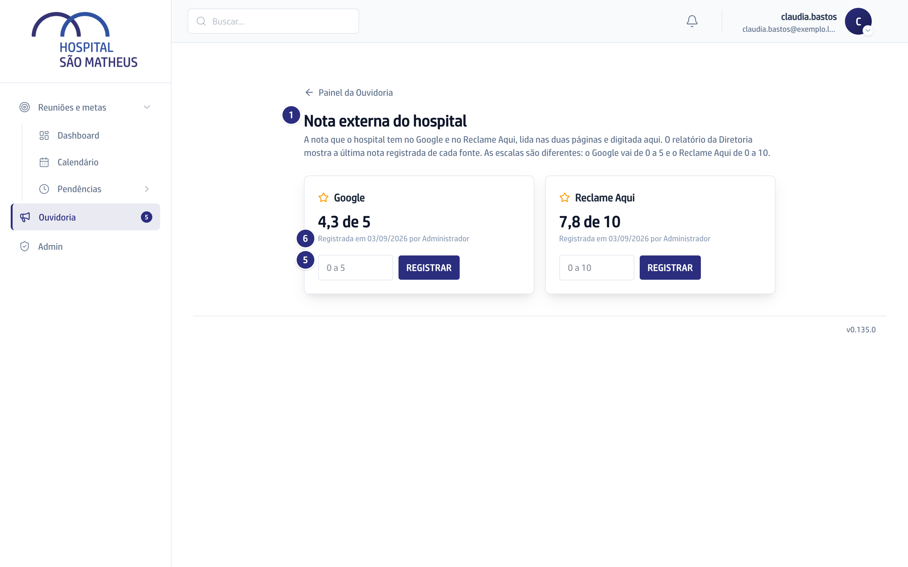

## Quando usar

Sempre que for fechar o mês ou a quinzena, antes do relatório sair. O sistema
não mede as duas notas sozinho; alguém abre as páginas, lê e digita.

## Passo a passo

1. Na Ouvidoria, abra o atalho **Nota externa**, que leva a **Nota externa do
   hospital**.

   

2. Abra a página do hospital no Google e leia a nota, de 0 a 5.
3. Digite o valor no cartão **Google** e clique em **Registrar**.
4. Abra a página do Reclame Aqui e leia o índice, de 0 a 10.
5. Digite o valor no cartão **Reclame Aqui** e clique em **Registrar**.
6. Confira a linha **Registrada em**, que mostra a data e quem lançou.

## Se der errado

- **Você digitou errado:** registre de novo com o valor certo. Cada lançamento
  vira uma linha nova, sem apagar o anterior, e vale a última de cada fonte.
- **As escalas parecem trocadas:** o Google vai até 5 e o Reclame Aqui até 10,
  e por isso as duas notas aparecem sempre com a escala junto.
- **Ninguém lançou no mês:** o relatório avisa que a nota não foi lançada, e a
  falta dela não conta como zero.
