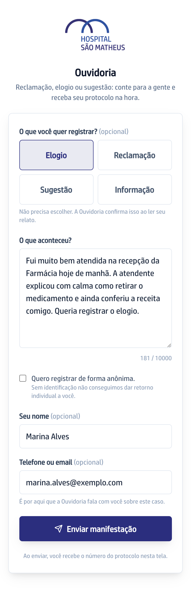

## Quando usar

Quando você quer contar alguma coisa para a Ouvidoria sem ter conta na
plataforma. A tela abre pelo QR do cartaz do setor ou pelo link no site do
hospital.

## Passo a passo

1. Abra o formulário. A tela mostra **Ouvidoria** no alto.

   

2. Se quiser, escolha **Elogio**, **Reclamação**, **Sugestão** ou
   **Informação**. A Ouvidoria confirma o tipo ao ler o seu relato.
3. Conte o que houve em **O que aconteceu?**, com as suas palavras.
4. Em **Este relato é sobre quem?**, escolha **Sobre mim** ou
   **Sobre outra pessoa**. Na segunda, você pode informar, se quiser, o
   **Nome do paciente** e **Quando ou onde foi o atendimento**.
5. Para não se identificar, marque **Quero registrar de forma anônima**. Senão,
   preencha **Seu nome** e **Telefone ou email**, para a Ouvidoria falar com
   você.
6. Clique em **Enviar manifestação**. Guarde o número do protocolo, que aparece
   nesta mesma tela.

## Se der errado

- **O botão Enviar manifestação está apagado:** falta escrever o relato, ou
  falta responder **Este relato é sobre quem?**. Com o relato escrito, a tela
  cobra a resposta que falta logo acima do botão.
- **Você marcou anônima e os campos de nome e contato sumiram:** é assim no
  registro anônimo. Sem contato, a Ouvidoria não tem como dar retorno a você.
- **Você leu o QR do cartaz e o setor não aparece no alto da tela:** registre
  assim mesmo. A Ouvidoria define o setor responsável ao ler o seu relato.
