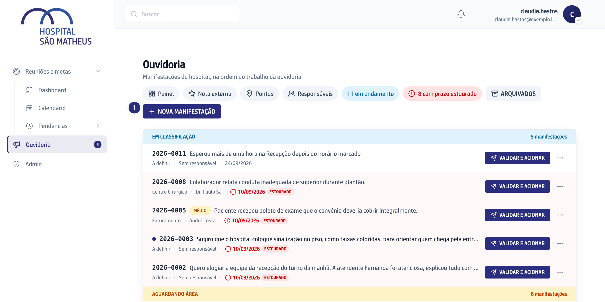
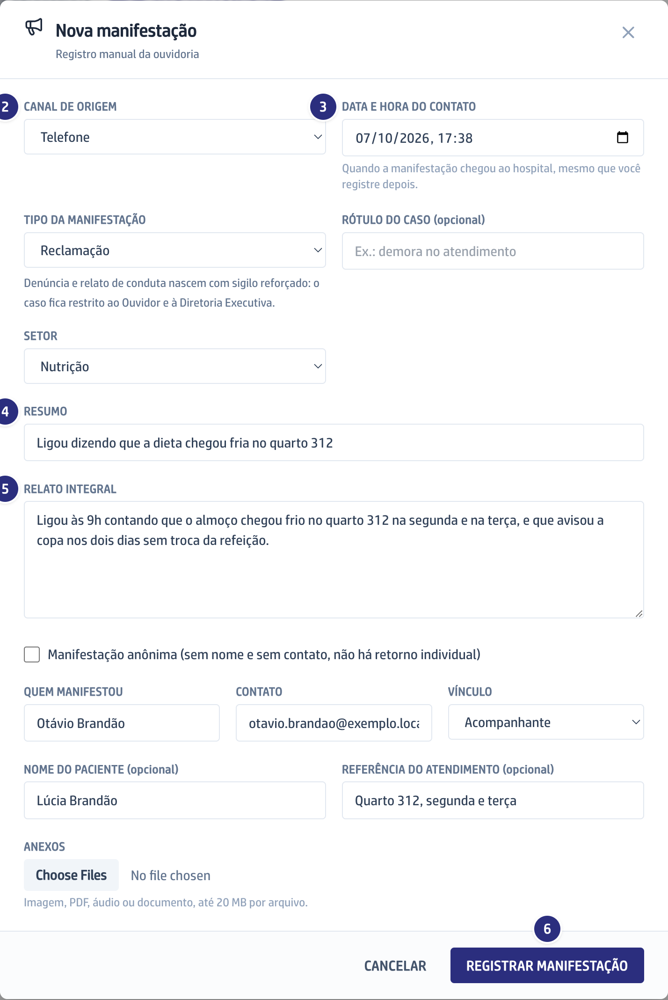
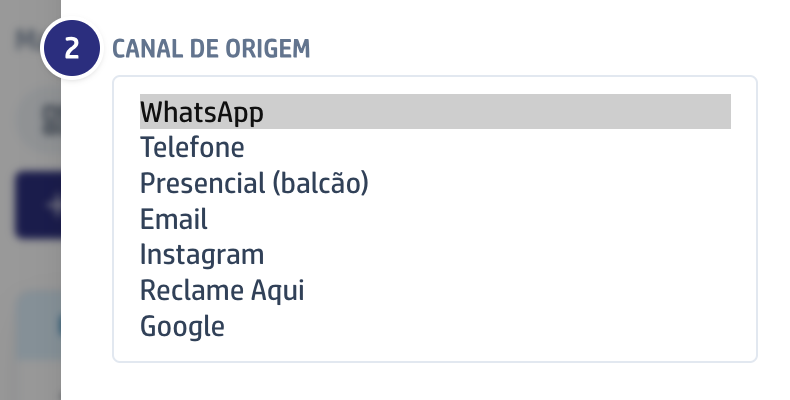

O vídeo é o capítulo 1, regravado na versão 0.137.1.

## Quando usar

Quando a pessoa ligou, veio ao balcão, mandou mensagem ou avaliou o hospital na
internet.

## Passo a passo

1. Na Ouvidoria, clique em **Nova manifestação**.

   

2. Confira o **Canal de origem**. A janela abre em **WhatsApp**; num
   telefonema, troque antes de salvar.

   

   

3. Preencha **Data e hora do contato** com a hora em que a pessoa falou. O prazo
   conta dali.
4. Escolha o **Tipo da manifestação** e o **Setor**, e escreva o **Resumo**.
   Denúncia e relato de conduta nascem sigilosos; os outros tipos aparecem na
   hora, sem o resumo, para quem tem papel nas Reuniões.
5. Cole em **Relato integral** o que a pessoa contou, sem corrigir, e preencha
   **Quem manifestou**, **Contato** e **Vínculo**. O endereço da avaliação na
   internet, ou o @ do Instagram, vai no **Contato**. Se a pessoa fala por
   outra, preencha **Nome do paciente** e **Referência do atendimento**.
6. Junte os **Anexos** e clique em **Registrar manifestação**. Passe a quem
   falou o protocolo que aparece na tela.

## Se der errado

- **A tela pede para conferir os campos:** relato, tipo, setor e resumo são
  obrigatórios, e a data não pode ser futura.
- **Você marcou WhatsApp e o caso era da Ana:** o que a Ana atende entra
  sozinho e conta separado. Aqui, WhatsApp é a conversa atendida por gente.
- **O canal ficou errado:** ele não muda depois de salvo. Anote o certo na
  **Observação da validação**, ao classificar.
