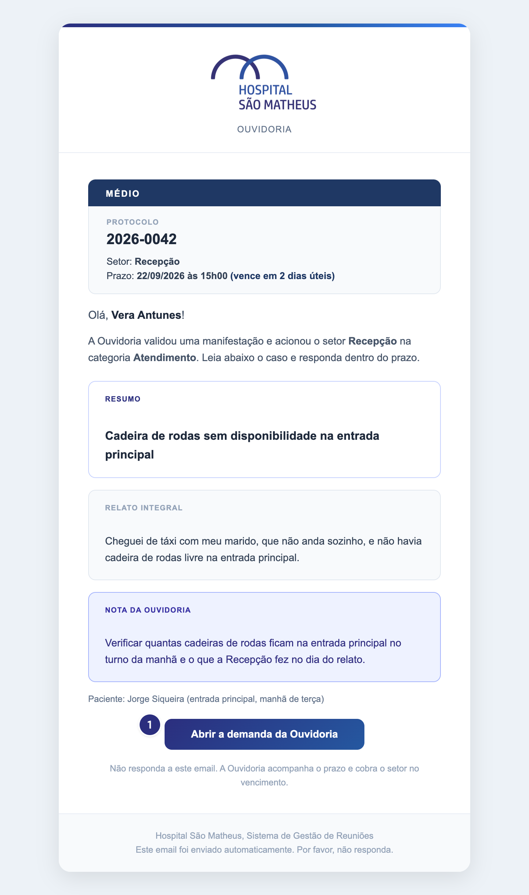
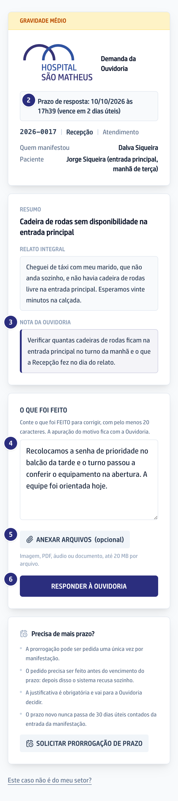

## Quando usar

Quando chega no seu email uma **Demanda da Ouvidoria** para a sua área. O link
é pessoal, vale para aquele caso e fecha depois da resposta.

## Passo a passo

1. Abra o email e toque no botão que leva ao caso, sem senha nem cadastro.

   

2. Veja a gravidade e o **Prazo de resposta**, no alto. Abaixo de **Quem
   manifestou** vem o **Paciente**, para achar o atendimento, se houver nome e
   o caso não for sigiloso.

   

3. Leia o caso até a **NOTA DA OUVIDORIA**, que diz o que você deve apurar.
4. Escreva em **O que foi feito** o que a área fez para corrigir; o motivo do
   problema fica com a Ouvidoria.
5. Use **Anexar arquivos** para imagem, PDF, áudio ou documento de até 20 MB.
6. Clique em **Responder à Ouvidoria**. A tela confirma o registro.

## Se der errado

- **O botão não envia:** a tela avisa se a resposta está curta demais ou se
  passou de 10.000 caracteres.
- **O caso não é do seu setor:** use o link **Este caso não é do meu setor?**.
  Veja [Devolver um caso que não é do seu setor](/ouvidoria/devolver-um-caso-que-nao-e-do-seu-setor/).
- **O prazo não dá:** veja
  [Pedir mais prazo pelo portal do setor](/ouvidoria/pedir-mais-prazo-pelo-portal-do-setor/).
- **A tela diz que o link não abre o caso:** ele é de uso único. Peça outro à
  Ouvidoria, citando o protocolo.
