## O envio é automático

Não existe botão de "enviar para assinatura". No instante em que o Validador
clica em **Aprovar validação**, o sistema monta o documento oficial da Versão e
o envia para as três pessoas do POP assinarem por email.

Os três recebem ao mesmo tempo e cada um assina quando puder, em qualquer
ordem. O Validador não precisa esperar o Elaborador. Se a mesma pessoa acumula dois
papéis, ela assina uma vez só.

## O que a Versão faz enquanto isso

Ela fica em **Em Assinatura**. O conteúdo está travado: ninguém edita, nem quem
elaborou. Na lista, o botão da linha vira **Ver**, e o documento pode ser lido
e baixado por quem tem o Setor no escopo.

Quando os três assinam, a Versão passa a **Publicado**, ganha a data de publicação e
aparece na Biblioteca com o documento assinado.

## Quando a assinatura não sai

O envio depende de cada uma das três pessoas ter email no cadastro. Faltando
um, o documento não sai e a Versão fica parada em **Em Assinatura**.

**Nenhuma tela tem botão de reenviar**, e corrigir o cadastro depois não faz o
documento sair sozinho. Nesse caso, avise quem cuida da plataforma, que faz o
reenvio por fora.

Enquanto isso, a Versão continua onde está, com o conteúdo travado, e as
aprovações do Revisor e do Validador seguem valendo.

## O POP publicado não sai da Biblioteca

Procedimento publicado continua na Biblioteca para sempre, mesmo passado o
intervalo de revisão que ele declara. Tirar da Biblioteca deixaria a equipe sem
referência nenhuma, que é pior do que uma referência antiga.
