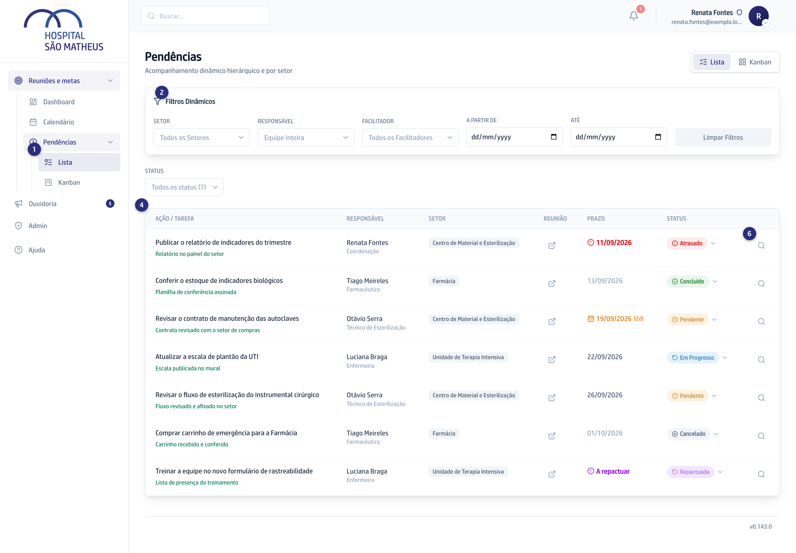
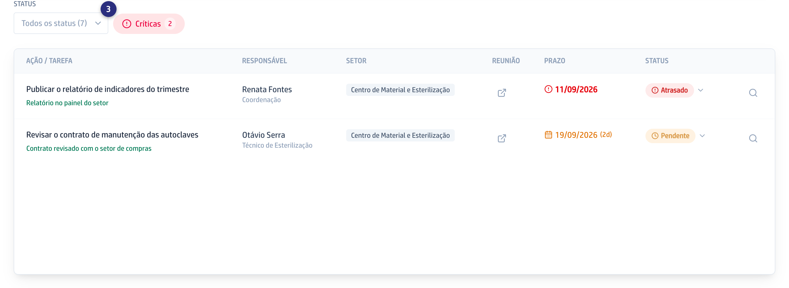
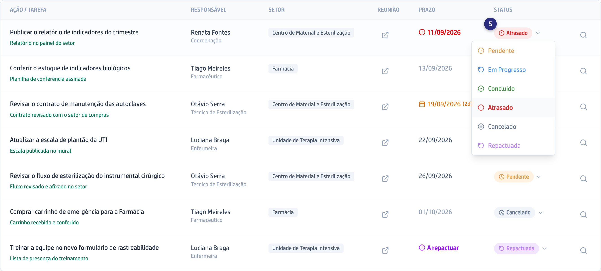

## Quando usar

Quando você quer ver de uma vez o atrasado, o que vence na semana e o que
está com cada setor.

## Passo a passo

1. No menu, abra **Reuniões e metas**, depois **Pendências**, depois **Lista**.

   
2. Abra **Filtros Dinâmicos** e recorte por **Facilitador**, **Status** ou
   prazo, entre **A partir de** e **Até**.
3. Para ver só o urgente, entre pelo cartão **Vencem em 3 dias** do
   **Dashboard**. A lista abre com o selo **Críticas** ligado: o que vence em
   até três dias e tudo o que atrasou. O selo desliga com um clique; só o
   cartão religa.

   
4. Leia a tabela: **Ação / Tarefa**, **Responsável**, **Setor**, **Reunião**,
   **Prazo** e **Status**.
5. Para mudar o estado, clique no selo da coluna **Status** e escolha
   **Pendente**, **Em Progresso**, **Concluido**, **Atrasado**, **Cancelado**
   ou **Repactuada**.

   
6. Para abrir a pendência, clique na lupa
   **Abrir detalhes da pendência**, no fim da linha.

## Se der errado

- **A tela avisa que há mais pendências do que mostra:** a lista tem teto e
  pode deixar o crítico de fora. Use os filtros.
- **O prazo aparece como A definir ou A repactuar:** a ação nasceu sem data ou
  foi remarcada sem a data nova. Abra a pendência e escreva o prazo.
- **Você não vê os filtros de Setor e Responsável:** só quem tem o acesso mais
  alto de Reuniões e metas vê os dois.
- **Você não acha a pendência de alguém:** clique em **Limpar Filtros** e
  procure de novo.
