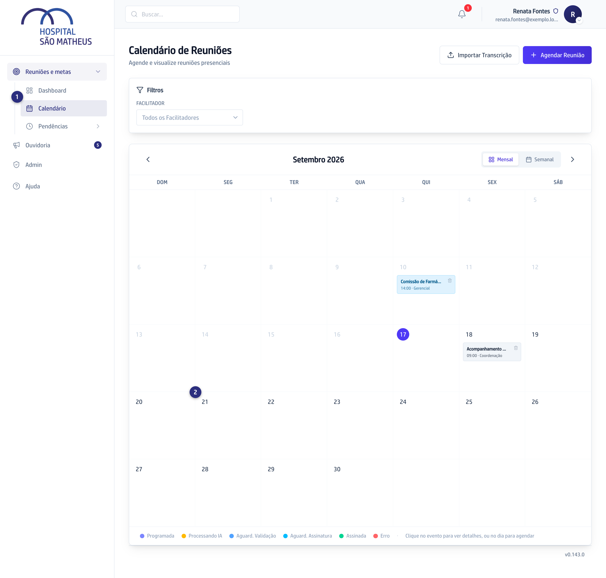
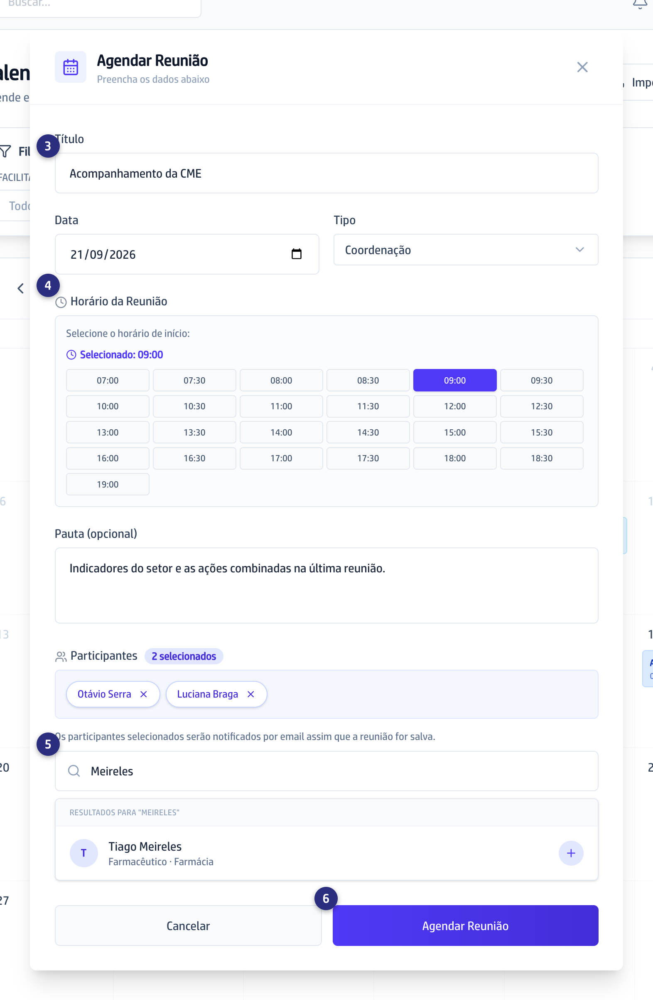

## Quando usar

Quando a reunião já tem data e você quer reservá-la e avisar quem vai.

:::caution[Quem marca vira o facilitador]
Quem agenda por aqui vira o facilitador da reunião e responde pela ata. Na
Secretaria é diferente: o clique leva para a tela **Marcar nova reunião**, em
que você escolhe quem vai conduzir.
:::

## Passo a passo

1. No menu, clique em **Calendário**. Ele fica no grupo **Reuniões e metas**;
   na Secretaria, fica solto no menu.

   
2. Clique no dia. A janela **Agendar Reunião** abre com a data preenchida. Na Secretaria, qualquer clique de agendar abre
   **Marcar nova reunião** com a data e a hora; siga em
   [Marcar a reunião de um facilitador](/reunioes/marcar-a-reuniao-de-um-facilitador/).
3. Escreva o **Título** e confira a **Data**. Em **Tipo**, escolha
   **Diretoria**, **Gerencial**, **Coordenação**, **Mensal** ou
   **Extraordinária**.

   
4. Em **Horário da Reunião**, escolha o início e escreva a
   **Pauta (opcional)**.
5. Em **Participantes**, procure cada pessoa em **Buscar participante...** e
   clique no nome.
6. Clique em **Agendar Reunião**. O convite sai por email na hora.

Reunião que se repete: abra ela e use **Recorrência**, depois **Configurar**.
A **Frequência** é **Semanal** ou **Quinzenal**.

## Se der errado

- **A pessoa que você procura não aparece:** a busca mostra só quem está
  cadastrado, dez por vez. Escreva mais letras do nome ou peça o cadastro a
  quem administra a plataforma.
- **Você marcou no dia errado:** abra a reunião e corrija a data enquanto ela
  estiver **Programada**. Para desistir, use a lixeira no cartão.
