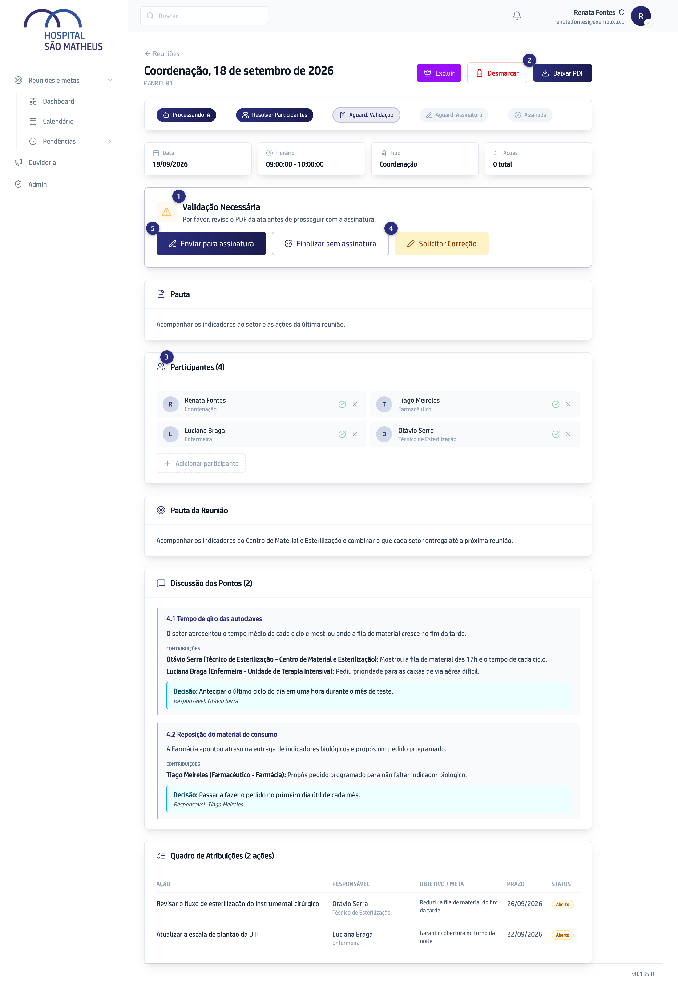
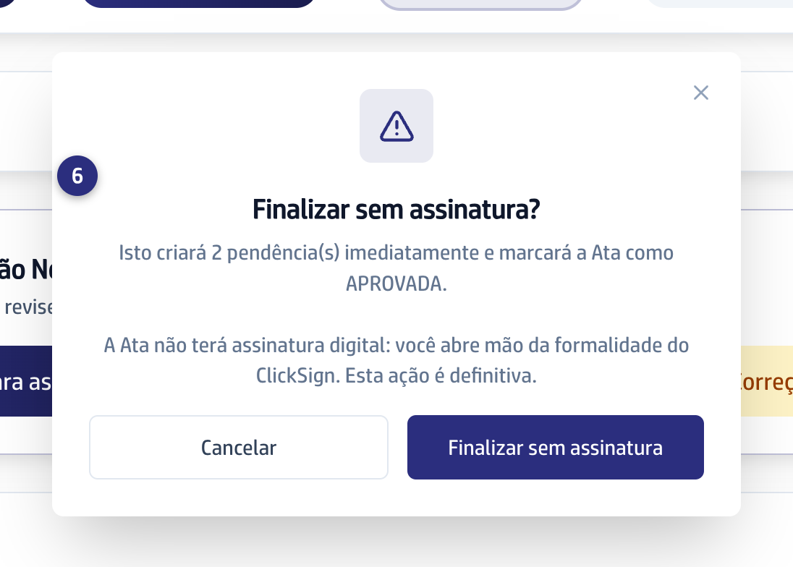

## Quando usar

Quando a ata já está escrita e a reunião mostra **Validação Necessária**. Aqui
você assume o texto, e depois de fechar não há volta.

## Passo a passo

1. Abra a reunião. O bloco **Validação Necessária** fica no alto.

   
2. Leia a ata inteira e confira o documento final em **Baixar PDF**.
3. Confira a lista de **Participantes**. O X tira a pessoa da ata e da lista de
   quem assina; a busca acrescenta quem faltou.
4. Para mudar o texto, clique em **Solicitar Correção** e diga o que muda. O
   assistente reescreve narrativa, discussão, quadro e objetivo, e deixa a lista
   de participantes como está.
:::caution[Finalizar sem assinatura não tem volta]
As pendências nascem na hora e assinar depois não existe.
:::

5. Escolha o desfecho: **Enviar para assinatura** ou
   **Finalizar sem assinatura**.
6. Finalizando sem assinatura, confirme na janela quantas pendências vão
   nascer.

   

## Se der errado

- **Você tirou alguém da ata por engano:** acrescente a pessoa de novo pela
  busca dos participantes. Ela volta para a ata e para a lista de quem assina
  sem receber email; o da assinatura só sai no envio.
- **A tela não deixa remover um participante:** quem responde por uma ação do
  quadro não sai da ata. Troque o responsável primeiro.
- **Você pediu a correção e o texto voltou igual:** peça de novo, citando a
  seção. **Apontar para esta seção** mira um trecho só.
- **Você finalizou sem assinatura e queria assinatura:** não tem volta.
