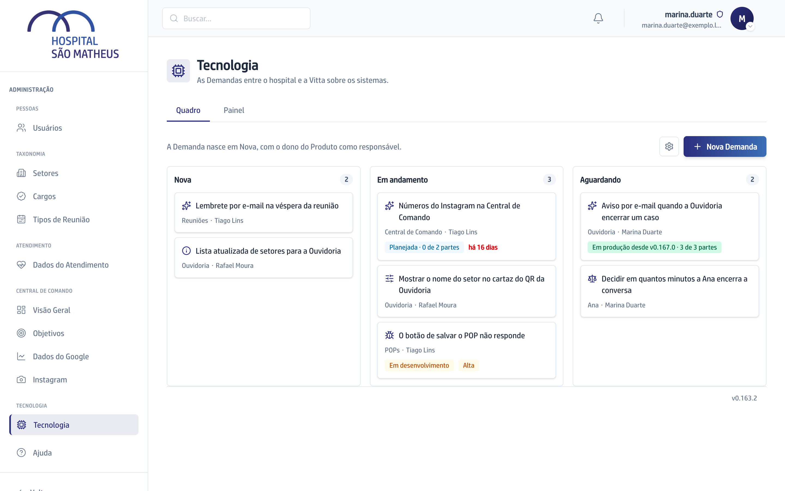

## Quando usar

Para ver de relance o que está aberto entre o hospital e a Vitta e de quem é a
vez em cada pedido.

## Passo a passo

1. Abra a aba **Tecnologia**. O **Quadro** é a primeira aba.
2. Leia as três raias: **Nova** (ninguém pegou ainda), **Em andamento**
   (alguém está com ela na mão) e **Aguardando** (a vez não é da Vitta, e o
   responsável diz com quem está).

   

3. Em cada card, leia o símbolo do tipo, o título, o Produto e o responsável.
4. Repare no que só aparece quando é exceção: o selo da Etapa quando a Demanda
   já foi para o desenvolvimento, a prioridade **Alta**, e a idade em vermelho
   a partir de 14 dias ou com o prazo vencido.
5. Clique no card para abrir tudo: descrição, imagens, Conversa e os botões.

O Quadro se atualiza sozinho a cada 30 segundos e quando você volta para a
janela. Demanda Concluída ou Cancelada sai do Quadro e fica no Histórico do
[Painel](../ler-o-painel/).

## Se der errado

- **Você não acha uma Demanda:** ela pode estar encerrada. Procure em
  **Buscar no Histórico**, no Painel.
- **O link recebido diz que a Demanda não está no Quadro:** ela foi concluída
  ou cancelada e mora no Histórico.
