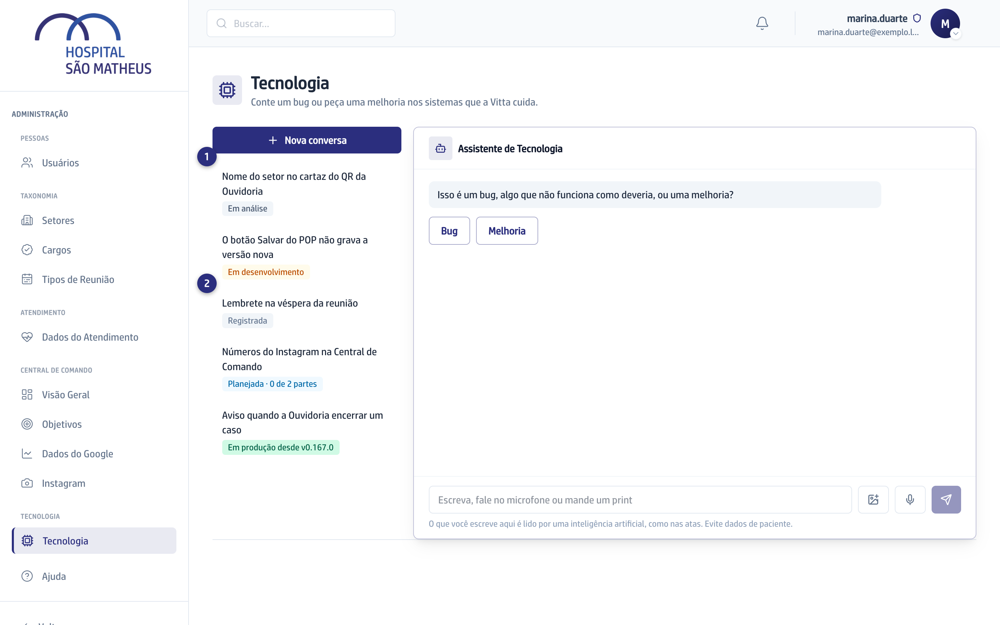
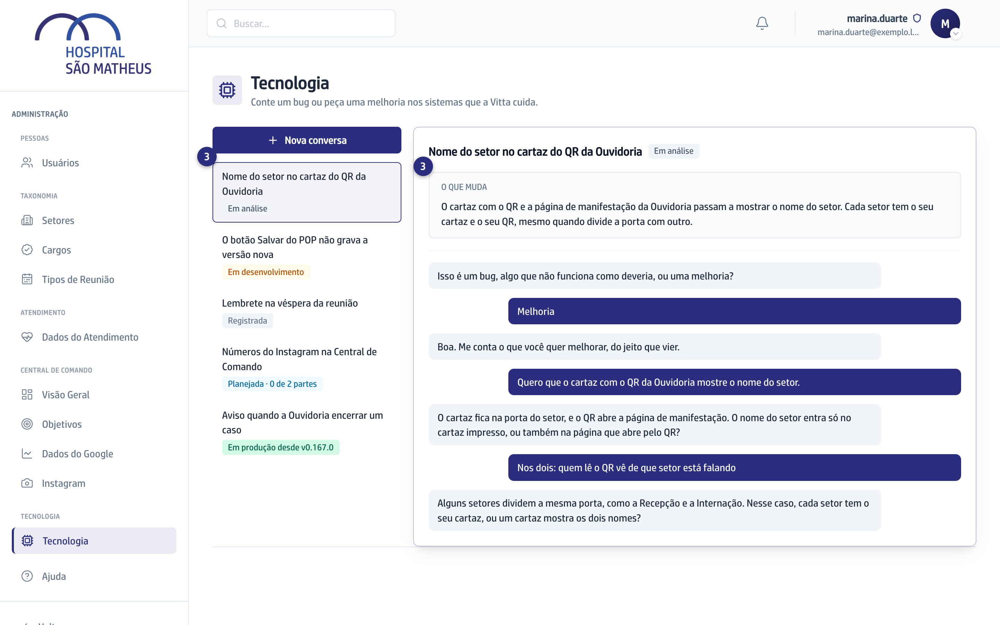

## Quando usar

Quando você quer saber se a Vitta já começou, se a entrega chegou ao app ou
retomar uma conversa que ficou no meio.

## Passo a passo

1. Abra a aba **Tecnologia**. Ao lado da conversa fica a lista dos seus
   pedidos, do mais recente para o mais antigo, cada um com a sua Etapa.
2. Clique num pedido **Registrada** para continuar a conversa de onde parou.
   Ele ainda não foi para a Vitta.

   

3. Clique num pedido que já foi para a Vitta para ver a Etapa e o
   **O que muda**, que é o que a entrega acrescenta para você.

   

A Etapa anda sozinha, sem ninguém digitar. O que cada uma quer dizer está em
[A Etapa e o O que muda](../como-funciona/a-etapa-e-o-que-muda/).

## Se der errado

- **Aparece "Descrição em preparação":** a Vitta ainda não escreveu o que a
  entrega muda.
- **Aparece "Não foi possível carregar as suas conversas":** recarregue a
  página.
- **Aparece "Este pedido é de antes do chat":** a conversa daquele pedido não
  ficou guardada aqui.
