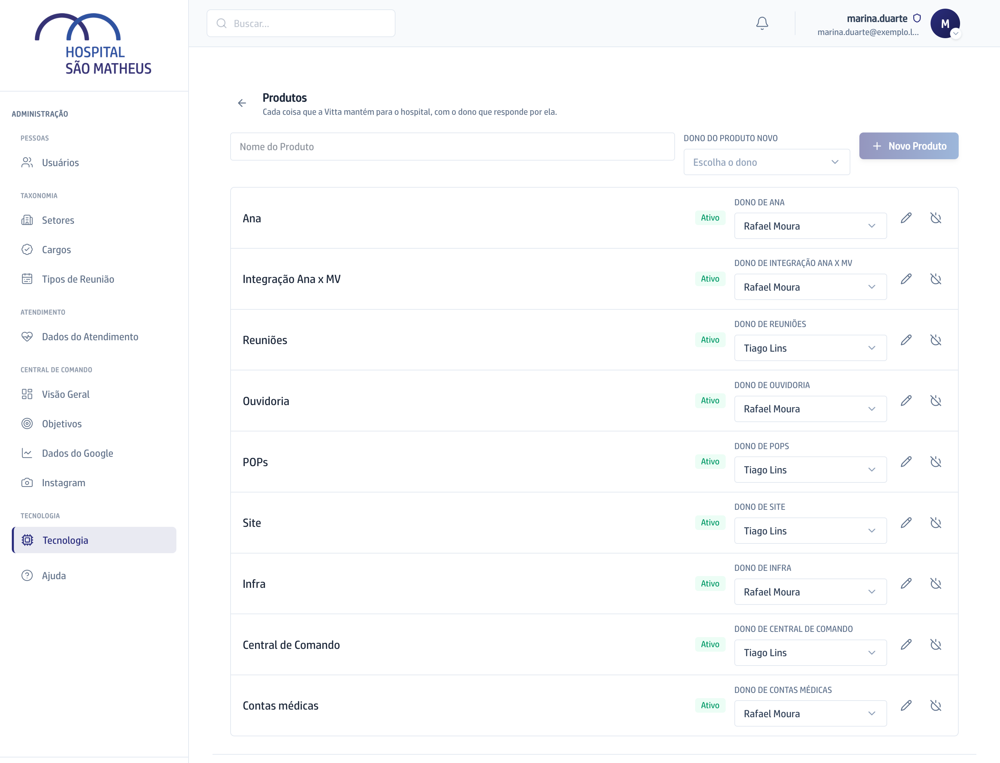

## Quando usar

Antes do primeiro uso, ou quando a Vitta passa a cuidar de um sistema novo ou
troca quem responde por um deles. A Demanda nova nasce na mão do dono do
Produto.

## Passo a passo

1. No **Quadro**, clique na engrenagem ao lado de **Nova Demanda**. A tela
   **Produtos** abre.

   

2. Para criar, escreva o **Nome do Produto**, escolha o dono em **Dono do
   Produto novo** e clique em **Novo Produto**.
3. Para trocar o dono, escolha outro nome na linha do Produto.
4. Para renomear, clique no lápis da linha, **Renomear**.
5. Para tirar o Produto da lista de escolha, clique no ícone de desligar,
   **Desativar**. As Demandas dele continuam onde estão.
6. Clique na seta do alto para voltar ao Quadro.

## Se der errado

- **A tela recusou salvar:** um Produto ativo precisa de dono. Sem dono, a
  Demanda nova nasceria sem ninguém na mão.
- **O Produto sumiu da Nova Demanda:** ele está desativado. Clique em
  **Reativar**, o ícone de ligar na linha dele.
