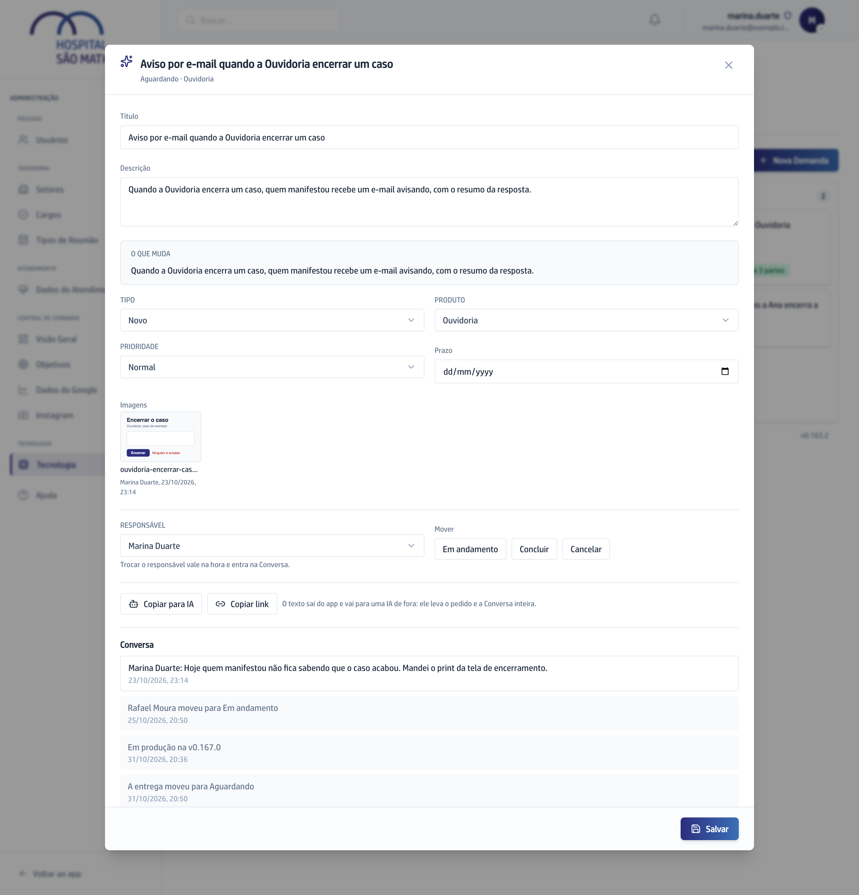

## Quando usar

Quando chega o e-mail **Demanda na sua mão** com o recado "Entregue, confira e
conclua". A entrega já está no app que você usa, a Demanda voltou para você em
**Aguardando** e aparece no **Com você** do Painel.

## Passo a passo

1. No **Painel**, em **Com você**, clique na linha marcada **Entregue, confira
   e conclua**.
2. Leia o **O que muda** do card: é o que a entrega acrescenta, parte por
   parte.

   

3. Teste no app o que foi entregue.
4. Se está bom, clique em **Concluir**, em **Mover**.
5. Se não está, escreva na Conversa o que faltou e clique em **Responder**. A
   resposta chega ao desenvolvimento e o trabalho é refeito no mesmo pedido,
   sem abrir Demanda nova.

Quem conclui é quem pediu, nunca a Vitta. Quando o pedido era uma decisão ou
uma consultoria, não há o que subir no app, e a Demanda volta para você já em
**Entregue**.

## Se der errado

- **O selo diz Não será feita:** a Vitta decidiu não fazer e explica o motivo
  na Conversa. A Demanda não muda de raia sozinha.
- **O selo de uma Demanda encerrada parou no tempo:** depois de fechada, ela
  não recebe mais notícia. Reabra para o selo voltar a se atualizar.
