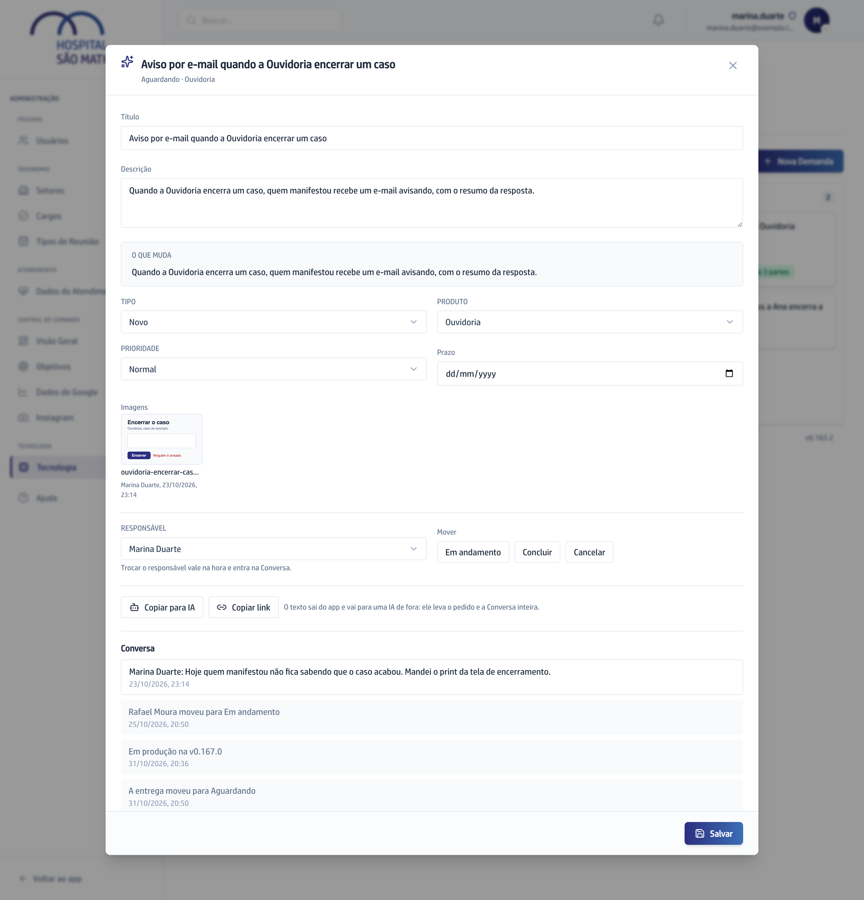

## Quando usar

Para perguntar, responder ou decidir um pedido. O que se combina na Conversa
fica guardado no card, em ordem, com autor, data e hora.

## Passo a passo

1. No **Quadro**, clique no card para abrir e desça até **Conversa**.
2. Escreva a sua resposta na caixa. Para chamar alguém, digite **@** e escolha
   o nome entre as pessoas com acesso à aba.
3. Para mandar um print junto, clique no botão de imagem ao lado de
   **Responder**.
4. Clique em **Responder**.

   

5. Errou a digitação? Você corrige a sua resposta por 10 minutos depois de
   enviar.

Quem você menciona recebe um e-mail e passa a ver a Demanda no **Com você** do
Painel até responder. O responsável da Demanda recebe e-mail a cada resposta
nova.

## Se der errado

- **Você corrigiu a resposta para pôr um @ e a pessoa não foi avisada:** a
  correção não manda e-mail. Escreva uma resposta nova.
- **Não dá mais para corrigir:** os 10 minutos passaram. Escreva uma resposta
  nova; nenhuma resposta é apagada.
- **O card avisa que a resposta também vai para a página pública:** a Demanda
  já foi para o desenvolvimento. Não escreva dado de paciente.
