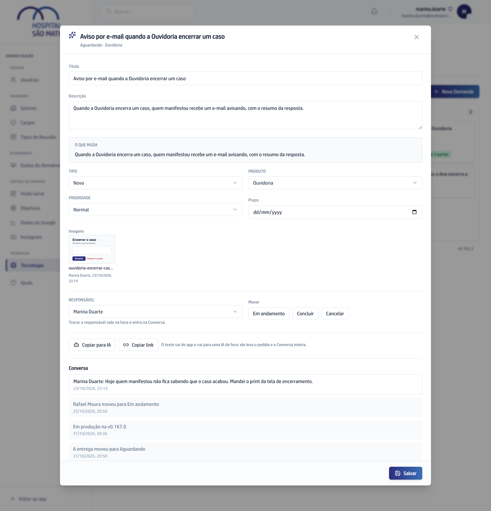

## Quando usar

Quando você quer a ajuda de uma IA de fora para pensar no pedido, ou precisa
puxar alguém para o card por fora do app.

## Passo a passo

1. No **Quadro**, clique no card para abrir.
2. Clique em **Copiar para IA**. O texto da Demanda inteira, com a Conversa e o
   **O que muda**, vai para a área de transferência.

   

3. Cole o texto na conversa da IA que você usa e volte com a resposta para a
   Conversa do card.
4. Para mandar o card a alguém, clique em **Copiar link** e cole onde quiser.
   Quem abre o link cai no card já aberto.

O texto copiado deixa de fora o responsável, a prioridade e o prazo, que não
ajudam a IA a responder. Ele sai do app: não cole Demanda com dado de paciente
numa IA de fora.

## Se der errado

- **Apareceu uma caixa com o texto embaixo dos botões:** o navegador não
  deixou copiar sozinho. O texto já vem selecionado: copie da caixa.
- **A tela diz que não foi possível montar o texto:** recarregue o Quadro e
  tente de novo.
- **Quem abriu o link caiu num aviso:** a Demanda foi encerrada e está no
  Histórico do Painel.
