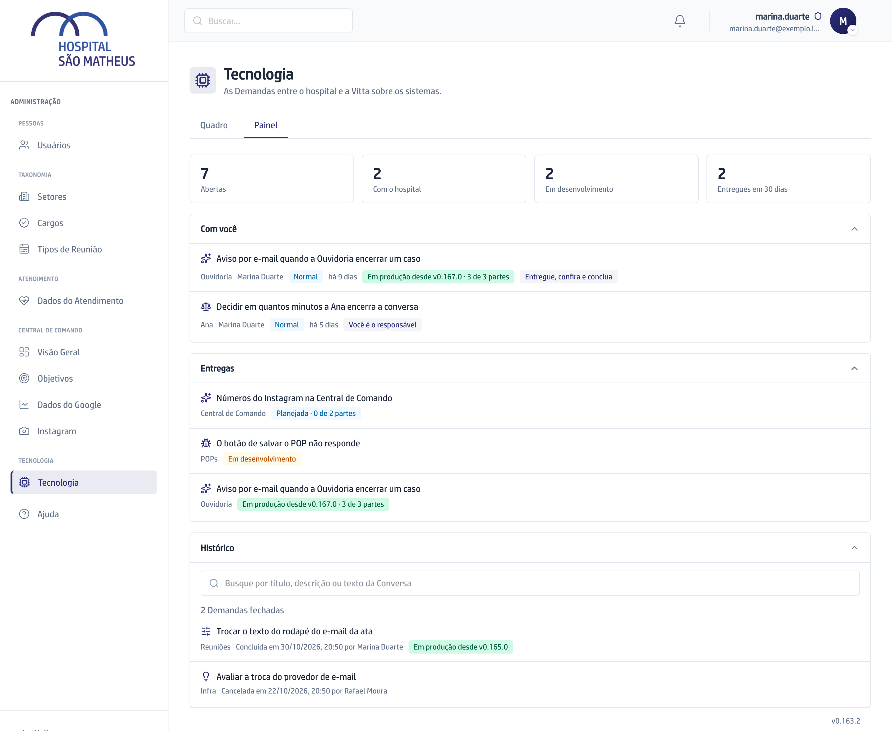

## Quando usar

Para responder "o que está comigo?", "o que está com o hospital?" e "o que a
Vitta está fazendo?" de uma vez.

## Passo a passo

1. Na aba **Tecnologia**, clique em **Painel**.
2. Leia os quatro números do alto: **Abertas**, **Com o hospital**, **Em
   desenvolvimento** e **Entregues em 30 dias**.

   

3. Em **Com você**, veja as Demandas que esperam por você. Cada linha diz o
   motivo: **Você é o responsável**, **Mencionaram você** ou **Entregue,
   confira e conclua**.
4. Em **Entregas**, acompanhe as Demandas ligadas ao desenvolvimento, com a
   Etapa e as partes.
5. Em **Histórico**, ache uma Demanda encerrada pela caixa **Buscar no
   Histórico**. A busca ignora acento e maiúscula.
6. Clique numa linha para abrir o mesmo card do Quadro.

Os blocos abrem e fecham com um clique no título. Os números são os mesmos para
todo mundo: não há número por pessoa.

## Se der errado

- **O que acabou de chegar não aparece:** o Painel não se atualiza sozinho.
  Troque de aba e volte, ou recarregue a página.
- **Com você está vazio:** nada espera por você agora.
