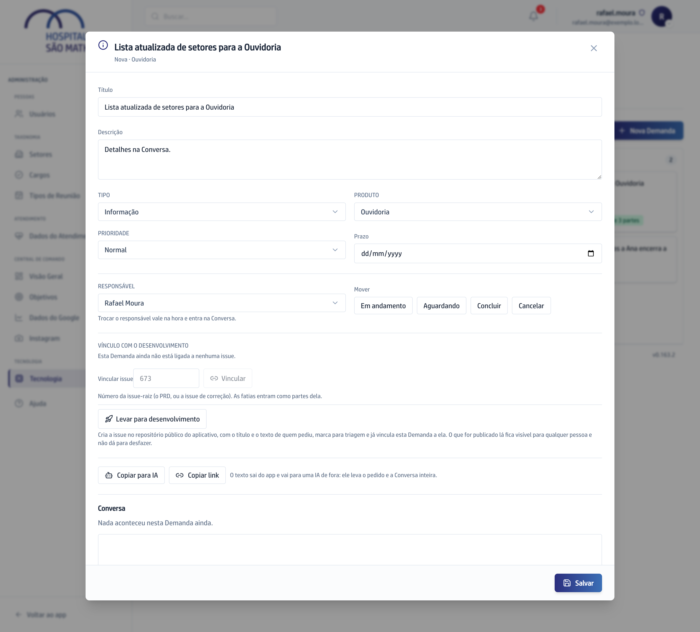

## Quando usar

Quando o pedido vai virar trabalho de desenvolvimento. Os controles só
aparecem para quem tem o campo Login no GitHub preenchido na ficha de Usuários.

## Passo a passo

1. No **Quadro**, abra o card e desça até **Vínculo com o desenvolvimento**.

   

2. Se o trabalho já existe, digite o número dele em **Vincular issue** e
   clique em **Vincular**.
3. Se ainda não existe, leia o aviso do botão e siga para o passo 4.

:::caution[Não tem volta]
O título e o texto de quem pediu passam a ser lidos por qualquer pessoa da
internet. Nada de nome de paciente ou valor de contrato.
:::

4. Clique em **Levar para desenvolvimento**. O app cria o trabalho com o texto
   do pedido e já liga a Demanda a ele.
5. Para desfazer a ligação, clique em **Desvincular**.

Com o Vínculo, o card ganha o selo da Etapa e o **O que muda**, e cada
resposta da Conversa também é publicada no trabalho. Veja
[O que vai para a página pública](../como-funciona/o-que-vai-para-a-pagina-publica/).

## Se der errado

- **A tela diz que o trabalho já está ligado a outra Demanda:** desfaça o
  Vínculo lá antes. Um trabalho responde por uma Demanda só.
- **O número foi recusado:** use o número do trabalho principal, não o de uma
  parte dele.
- **Os botões estão apagados com um aviso amarelo:** a integração não está
  configurada no servidor. Avise quem cuida dele.
