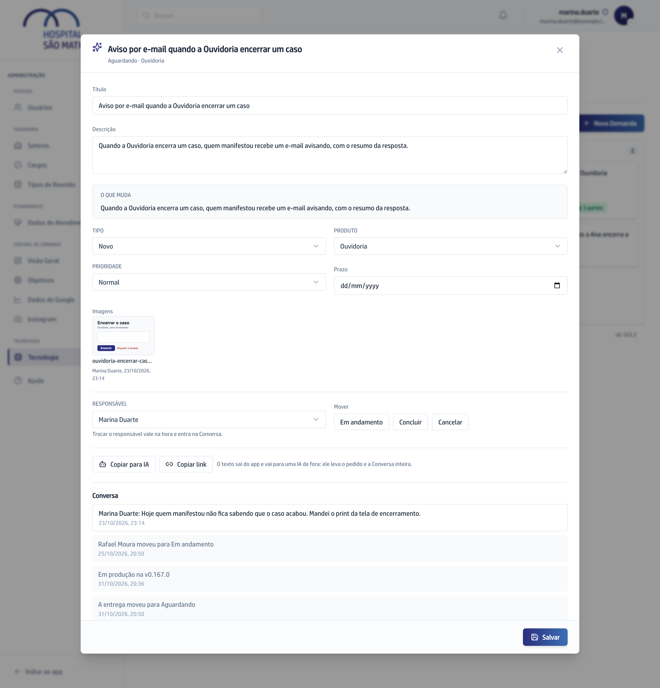

## Quando usar

Quando a vez muda de mão, quando o assunto acabou ou quando ele não vai
acontecer.

## Passo a passo

1. No **Quadro**, clique no card para abrir.
2. Para passar a Demanda a outra pessoa, escolha o nome em **Responsável**. A
   troca vale na hora e entra na Conversa.
3. Em **Mover**, clique na raia nova: **Em andamento** ou **Aguardando**.
   Arrastar o card entre as raias dá no mesmo.
4. Quando o assunto acabou, clique em **Concluir**. Se não vai acontecer,
   clique em **Cancelar**.

   

5. Para reabrir uma Demanda encerrada, abra-a no Histórico do Painel e clique
   em **Em andamento**.

Não existe botão de excluir Demanda. A Cancelada continua no Histórico. Mover não manda e-mail a ninguém; trocar o
responsável manda.

## Se der errado

- **A tela recusou o movimento:** outra pessoa moveu o mesmo card antes de
  você. Recarregue a página e mova de novo.
- **O card mudou de raia sozinho:** só a entrega faz isso, quando chega ao app
  e volta para quem pediu. Veja [Conferir e concluir uma entrega](../conferir-e-concluir-uma-entrega/).
