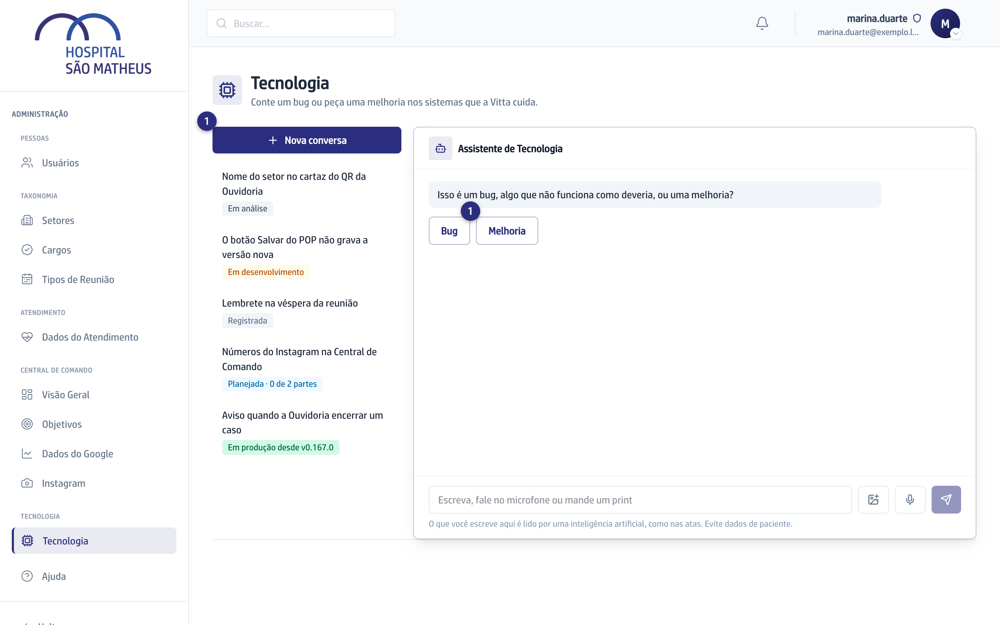
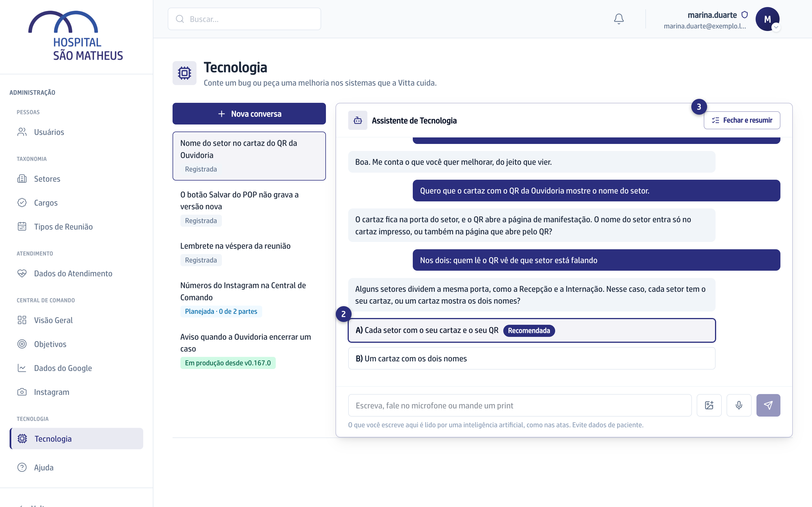
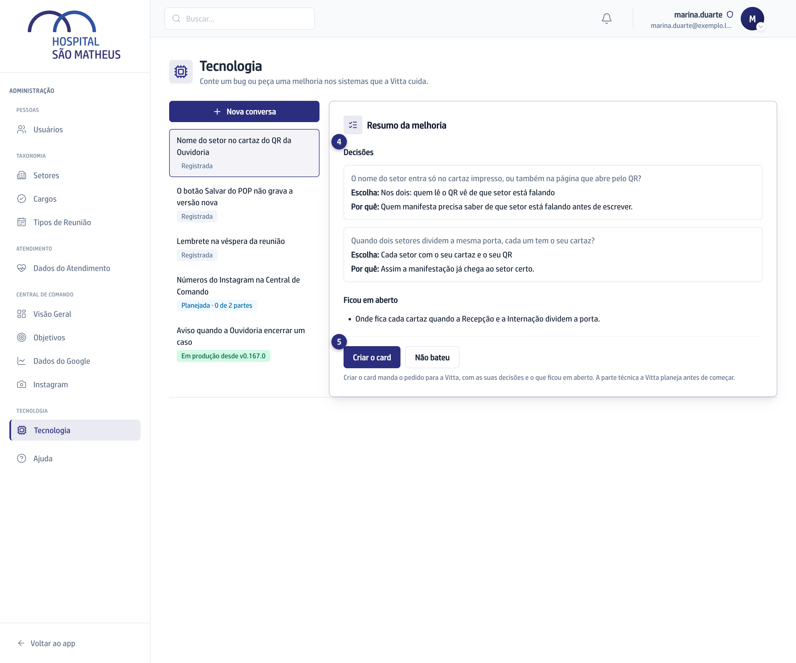

## Quando usar

Quando você quer algo novo num dos sistemas, ou uma mudança no que já existe.
A IA faz as perguntas que a Vitta faria, uma por vez, e quem decide é você.

## Passo a passo

1. Na aba **Tecnologia**, clique em **Nova conversa** e depois em
   **Melhoria**. Conte o que você quer, do seu jeito.

   

2. Leia a pergunta e clique numa das duas opções. A que a IA recomenda vem
   marcada com **Recomendada**. Se nenhuma servir, responda na caixa ou pelo
   microfone.
3. Quando quiser parar, clique em **Fechar e resumir**. São no máximo 12
   perguntas.

   

4. Confira as **Decisões** e o que **Ficou em aberto**. Se algo estiver
   errado, clique em **Não bateu**, diga o quê, e as perguntas seguem.

:::caution[Não tem volta]
**Criar o card** manda o pedido para a Vitta, com as suas decisões e o que
ficou em aberto.
:::

5. Clique em **Criar o card**.

   

## Se der errado

- **A IA avisou de um pedido parecido:** já existe um pedido aberto sobre o
  mesmo assunto. Veja se não é o mesmo antes de criar o card.
- **Aparece "A IA já tem o que precisa":** o resumo vem em seguida. Se não
  vier, clique em **Fechar e resumir**.
- **Você saiu no meio:** a conversa ficou guardada. Clique nela na lista ao
  lado e continue de onde parou.
