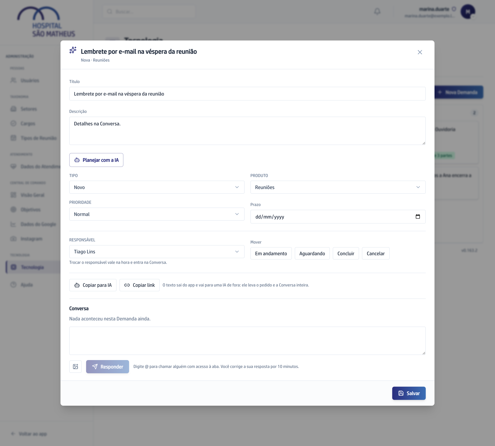
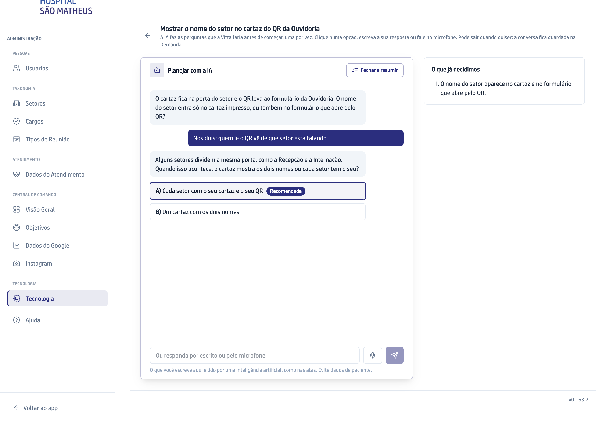

## Quando usar

Quando a Demanda é do tipo **Novo** ou **Ajuste** e ainda não foi para o
desenvolvimento. A IA faz as perguntas que a Vitta faria, uma por vez, e quem
decide é você.

## Passo a passo

1. No **Quadro**, abra o card e clique em **Planejar com a IA**.

   

2. Leia a pergunta e clique numa das duas opções. A recomendada vem marcada
   com **Recomendada**. Se nenhuma servir, responda por escrito ou pelo
   microfone.
3. Acompanhe as suas escolhas em **O que já decidimos**, à direita.

   

4. Quando quiser parar, clique em **Fechar e resumir**. São no máximo 12
   perguntas.
5. Confira o resumo. Se algo não bateu, clique em **O que não bateu**, diga o
   quê e a conversa continua.

:::caution[Não tem volta]
O sim manda o plano para a Vitta e liga a Demanda ao desenvolvimento.
:::

6. Clique em **Sim, mandar para os desenvolvedores**. A Demanda passa para a
   Etapa **Em análise** e o card mostra **O que muda** com o que você decidiu.

## Se der errado

- **O botão não aparece no card:** a Demanda não é **Novo** nem **Ajuste**, já
  foi para o desenvolvimento ou está encerrada.
- **Você saiu no meio:** a conversa ficou guardada. Abra o card e clique em
  **Continuar planejamento**.
