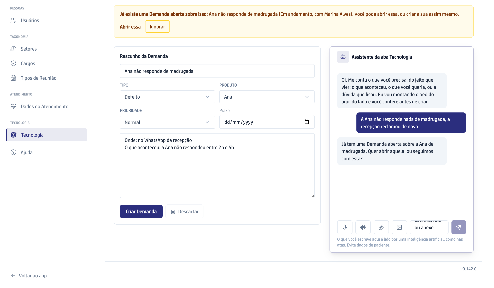

## Quando usar

Quando você tem um pedido sobre os sistemas e prefere contar do seu jeito, em
vez de preencher campo por campo.

## Passo a passo

1. No **Quadro**, clique em **Nova Demanda**.
2. Conte o que precisa na caixa **Escreva, fale ou anexe**. Dá para escrever,
   gravar a voz, anexar um áudio, um documento ou um print da tela.
3. Responda às perguntas do assistente. São no máximo três, uma de cada vez.
   Ao lado, o **Rascunho da Demanda** vai se montando.

   

4. Confira o rascunho e corrija à mão o campo que quiser.
5. Se aparecer a faixa de Demanda parecida, clique em **Abrir essa** para ir
   ao card que já existe, ou em **Ignorar** para seguir com a sua.
6. Clique em **Criar Demanda**. Ela nasce em **Nova**, já com o dono do
   Produto como responsável, e ele recebe um e-mail.

## Se der errado

- **O assistente respondeu em vez de registrar:** a resposta estava no
  material da Vitta, e ele diz de onde tirou. Se ainda quiser o pedido, diga
  que quer registrar.
- **O print sumiu:** a conversa só vira Demanda no **Criar Demanda**. Sem o
  clique, o print some com ela.
- **Você prefere o formulário:** clique em **prefiro preencher à mão**, no alto
  da tela.
