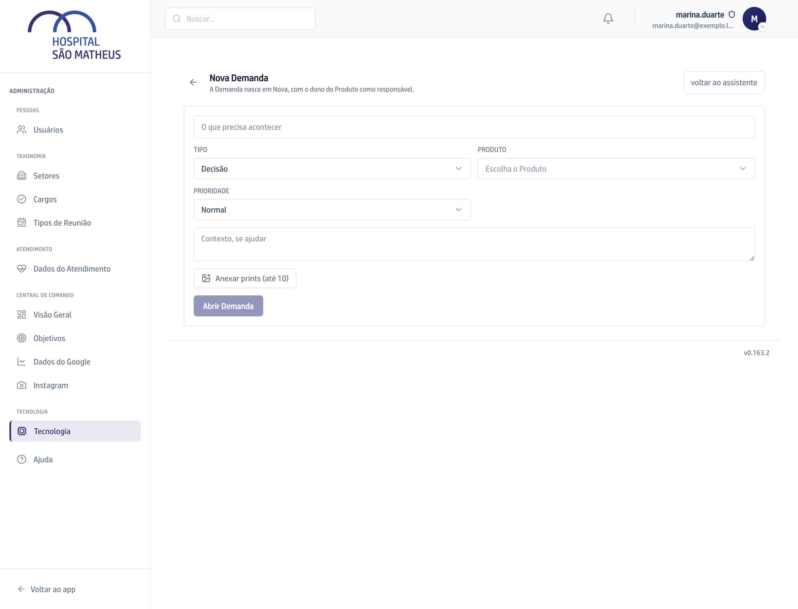

## Quando usar

Quando você já sabe o que pedir e quer preencher direto, sem conversar com o
assistente.

## Passo a passo

1. No **Quadro**, clique em **Nova Demanda** e, no alto da tela, em
   **prefiro preencher à mão**.
2. Escreva o título em **O que precisa acontecer**.
3. Escolha o **Tipo**, o **Produto** e a **Prioridade**. Na dúvida sobre o
   tipo, veja [Os sete tipos](../como-funciona/os-sete-tipos/).
4. Em **Contexto, se ajudar**, conte o que se fez, o que apareceu e o que se
   esperava.
5. Clique em **Anexar prints (até 10)** se uma imagem ajudar. Vale PNG, JPG ou
   WEBP, de até 5 MB cada.

   

6. Clique em **Abrir Demanda**. Ela nasce em **Nova**, com o dono do Produto
   como responsável.

## Se der errado

- **O botão Abrir Demanda está apagado:** falta o título ou o **Produto**.
- **O print foi recusado:** passou de 5 MB, não é imagem, ou a Demanda já tem
  10.
- **Você errou um campo depois de criar:** abra o card e corrija. Não precisa
  cancelar e abrir outra.
