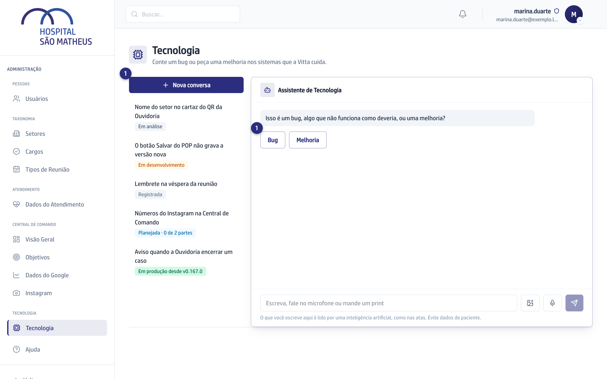
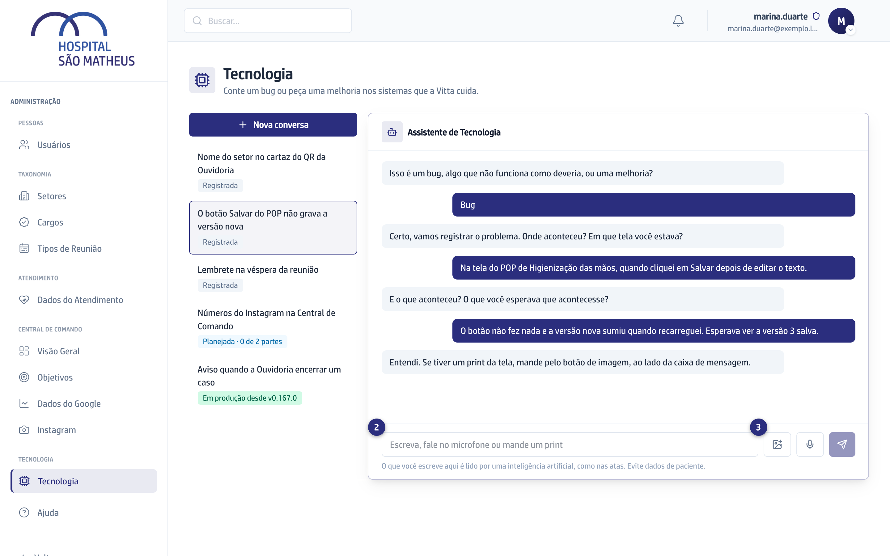
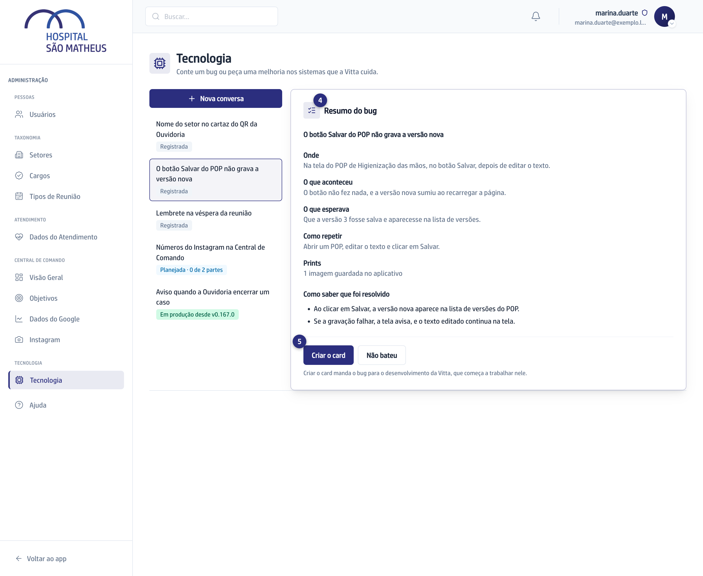

## Quando usar

Quando alguma coisa num dos sistemas dá errado, como um botão que não
responde, uma tela que não abre ou um número que não bate.

## Passo a passo

1. Na aba **Tecnologia**, clique em **Nova conversa** e depois em **Bug**.

   

2. Responda às perguntas da IA, uma por vez: onde aconteceu, o que aconteceu,
   o que você esperava e como repetir. São no máximo cinco. Escreva na caixa
   ou fale pelo microfone.
3. Se tiver um print da tela, mande pelo botão de imagem, ao lado da caixa.

   

4. Confira o **Resumo do bug**. Se algo estiver errado, clique em
   **Não bateu**, diga o quê, e a conversa continua.

:::caution[Não tem volta]
**Criar o card** manda o bug para o desenvolvimento da Vitta, que começa a
trabalhar nele.
:::

5. Clique em **Criar o card**.

   

## Se der errado

- **Aparece "Um print da conversa não entrou como imagem":** mande o print de
  novo na conversa.
- **Aparece "A conversa mudou em outra aba":** recarregue a página e tente de
  novo.
- **Você saiu no meio:** a conversa ficou guardada. Clique nela na lista ao
  lado e continue de onde parou.
