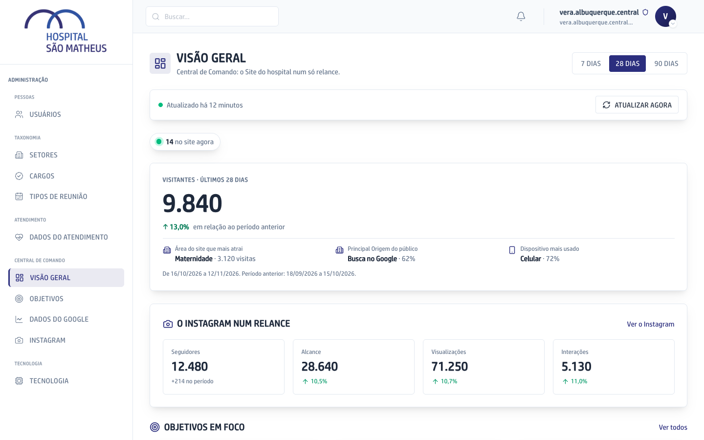
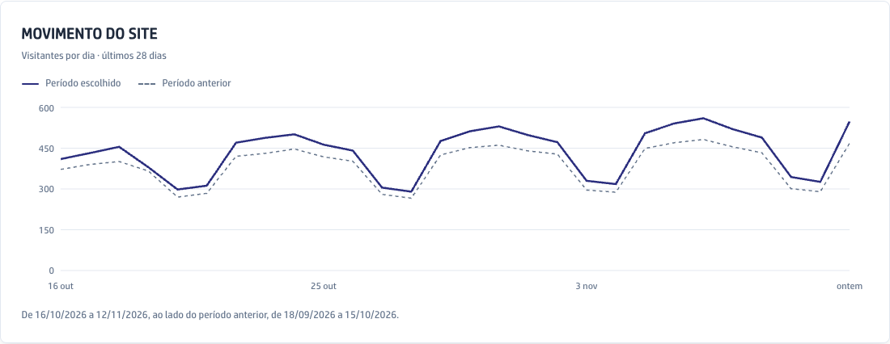
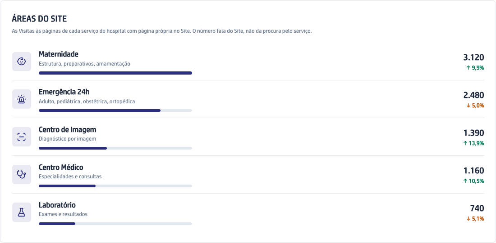
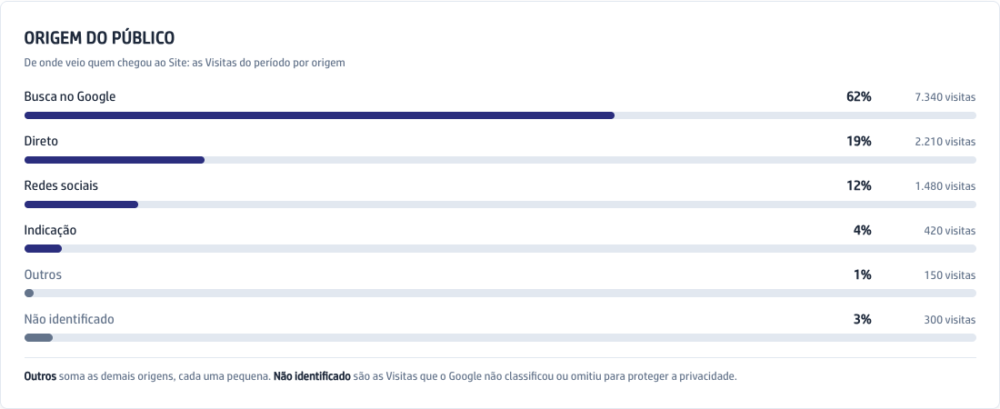
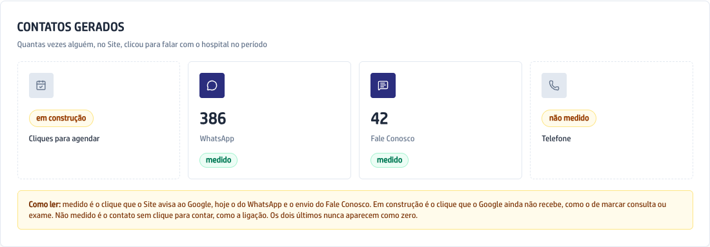
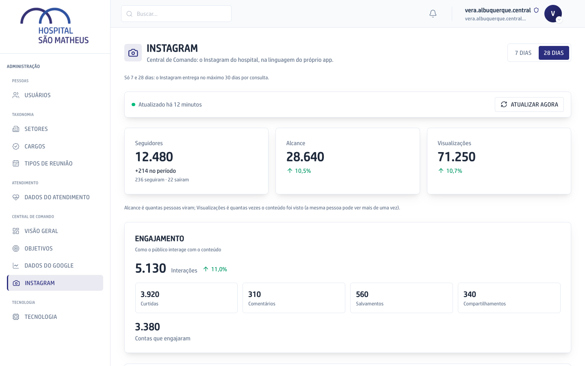
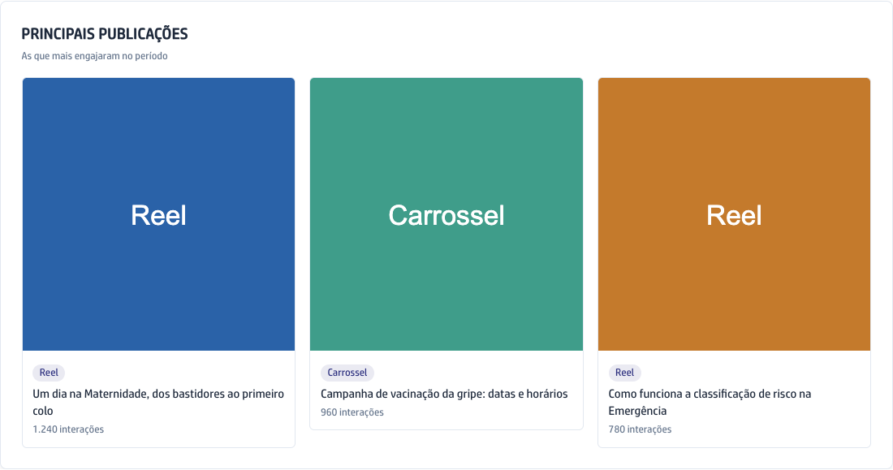
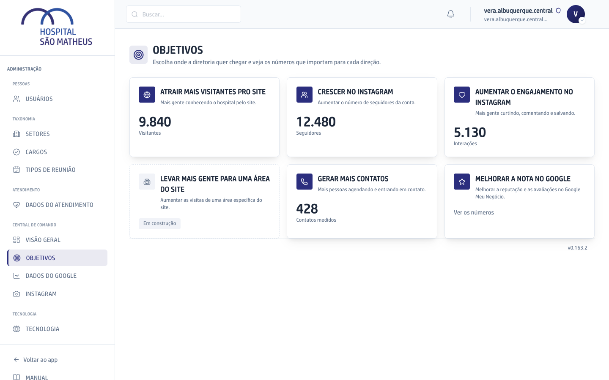
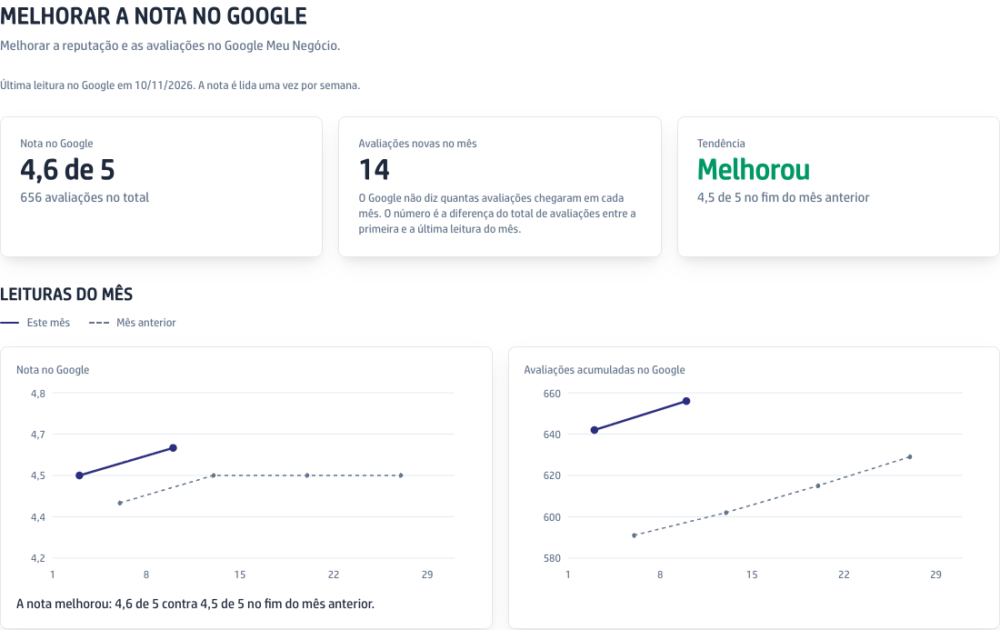
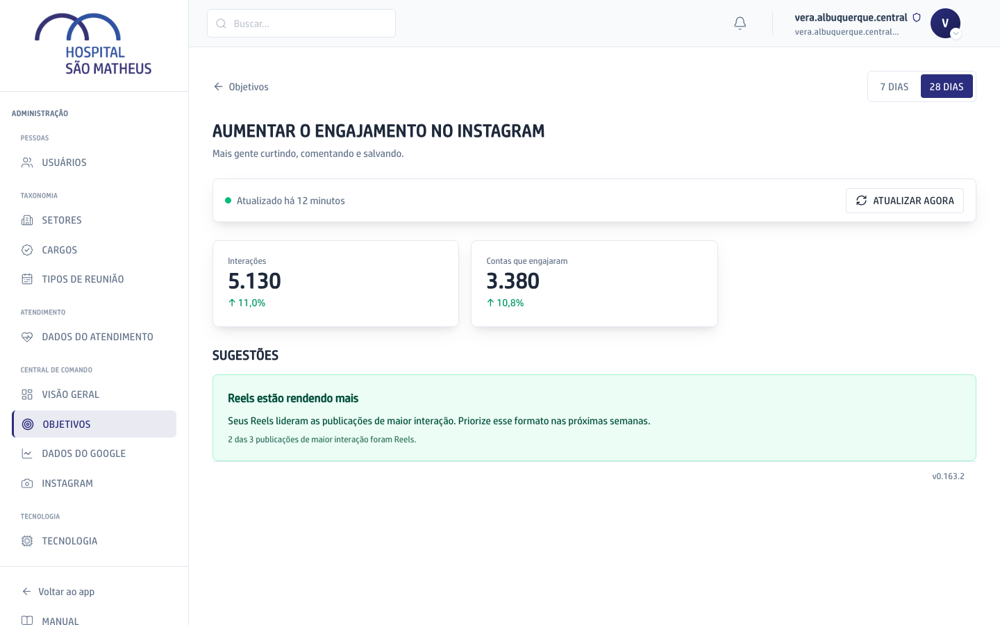

A Central de Comando junta num lugar só os números do site do hospital, do Instagram e da nota no Google. Por ela você acompanha os números; o site e o Instagram continuam sendo mexidos fora do app.

Ela fica na área de Administração, e só o Super admin vê. Quando a fonte de um número não está ligada, a tela diz que ele não é medido, em vez de mostrar zero.

## Ver o panorama na Visão Geral

1. No menu da esquerda, clique em **Admin**.
2. Na seção **Central de Comando**, clique em **Visão Geral**.
3. No alto, à direita, escolha o período: **7 dias**, **28 dias** ou **90 dias**. A tela abre em 28 dias.
4. Leia o número grande: são os Visitantes do site no período, ou seja, quantas pessoas diferentes entraram. A seta ao lado compara com o período anterior, do mesmo tamanho: verde quando subiu, laranja quando caiu.
5. Logo abaixo aparecem a Área do site que mais atrai, de onde veio a maior parte do público e o aparelho mais usado.
6. A bolinha verde mostra quantas pessoas estão no site agora. Esse número se renova sozinho a cada 30 segundos.
7. Mais abaixo vêm o Instagram num relance, os Objetivos em foco e os atalhos para as outras telas. No pé da página, **O que vem por aí** conta o que ainda vai nascer na Central.



A barra branca acima dos números diz de quando eles são. Os números do site e do Instagram são buscados de novo a cada hora. Para buscar na hora, clique em **Atualizar agora**. Se a busca falhar, a tela continua mostrando o último número bom e avisa que não conseguiu atualizar.

## Ler os números do site

1. Na seção **Central de Comando** do menu, clique em **Dados do Google**.
2. Escolha o período no alto, à direita.
3. Em **Movimento do site**, a linha azul mostra os Visitantes de cada dia do período escolhido. A linha cinza tracejada, atrás, é o período anterior, para comparar. Passe o mouse sobre um dia para ver o número exato e a diferença para o dia correspondente do período anterior.



4. Em **Áreas do site**, veja as cinco partes do site que mais recebem Visitas, como Maternidade e Emergência 24h. A seta mostra se cada uma subiu ou caiu. O número conta Visitas às páginas do site e não mede quanto o serviço é procurado no hospital.



5. Em **Origem do público**, cada barra mostra de onde veio quem chegou ao site: pela busca do Google, digitando o endereço, pelas redes sociais ou por outro site. O que o Google não sabe dizer aparece como **Não identificado**.



6. Em **Por dispositivo**, veja quanto do público usa celular, computador ou tablet.
7. Em **Contatos gerados**, veja quantas vezes alguém clicou no site para falar com o hospital, canal por canal. Cada canal diz se é **medido**, se está **em construção** (o site ainda não avisa quando o clique acontece) ou se **não é medido**.



## Ler os números do Instagram

1. Na seção **Central de Comando** do menu, clique em **Instagram**.
2. Escolha **7 dias** ou **28 dias**. O Instagram não entrega mais de 30 dias por consulta, por isso não há 90 dias aqui.
3. Leia os três cartões do alto. **Seguidores** é o total de hoje, com quantos chegaram menos quantos saíram no período. **Alcance** é quantas pessoas diferentes viram o conteúdo. **Visualizações** é quantas vezes o conteúdo foi visto, contando a mesma pessoa mais de uma vez.



4. No bloco de engajamento, **Interações** soma curtidas, comentários, salvamentos e compartilhamentos. Ao lado, as contas que engajaram dizem quantas pessoas fizeram isso.
5. Em **Principais publicações**, veja as publicações do período com mais Interações. Clique numa delas para abrir no Instagram.



## Acompanhar a nota no Google

1. Na seção **Central de Comando** do menu, clique em **Objetivos**.
2. Clique no cartão **Melhorar a nota no Google**.



3. Leia os três cartões. **Nota no Google** é a nota de hoje, com o total de avaliações. **Avaliações novas no mês** é quantas chegaram desde a primeira leitura do mês. **Tendência** diz se a nota melhorou, piorou ou ficou igual frente ao fim do mês anterior.
4. Abaixo, os dois gráficos do mês mostram cada leitura da nota e do total de avaliações. A linha cinza tracejada é o mês anterior, dia a dia.



A nota é lida no Google uma vez por semana, e a data da última leitura aparece acima dos cartões. Por isso esta tela não tem o botão **Atualizar agora**.

## Seguir um Objetivo

Cada Objetivo é uma direção que a diretoria quer para o site e o Instagram, como crescer no Instagram ou gerar mais contatos. Ele mostra os números que importam para aquela direção e dá sugestões, sem uma meta em número para bater.

1. Na seção **Central de Comando** do menu, clique em **Objetivos**.
2. Clique no cartão do Objetivo. Os cartões apagados ainda estão em construção e não abrem.
3. Escolha o período no alto, à direita.
4. Leia os números do Objetivo, cada um comparado com o período anterior.
5. Leia as sugestões. Cada uma traz, embaixo, o dado que a fez aparecer. Quando nada pede atenção, a tela diz que está tudo no rumo.



## De onde vem cada número

```fluxograma
inicio ga 1,1: Google Analytics | O Google conta quem entra no site do hospital.
inicio ig 1,3: Instagram | A conta do hospital no Instagram entrega os números dela.
inicio gmn 1,4: Google Meu Negócio | A nota e o total de avaliações que o Google mostra do hospital.
passo aovivo 2,1: Ao vivo, a cada 30 segundos | Quantas pessoas estão no site agora. Esse número não é guardado.
passo guarda 2,2: Guardados de hora em hora | O app busca de novo a cada hora, ou na hora com Atualizar agora. Se a fonte falha, fica o último número bom.
passo semana 2,4: Lida uma vez por semana | O app lê a nota no Google toda semana e guarda cada leitura.
fim visao 3,1: Visão Geral | O panorama: Visitantes, Ao vivo, o Instagram num relance e os Objetivos em foco.
fim dados 3,2: Dados do Google | O Movimento do site, as Áreas do site, a Origem do público, os aparelhos e os Contatos gerados. As lentes dos Objetivos também leem daqui.
fim tig 3,3: Tela do Instagram | Seguidores, Alcance, Visualizações, Interações e as Principais publicações.
fim nota 3,4: Melhorar a nota no Google | A nota, as avaliações novas do mês, a tendência e o gráfico do mês.
ga -> aovivo
ga -> guarda
ig -> guarda
gmn -> semana
aovivo -> visao
guarda -> visao
guarda -> dados
guarda -> tig
semana -> nota
```
