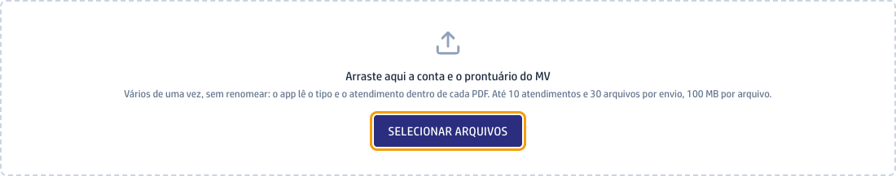
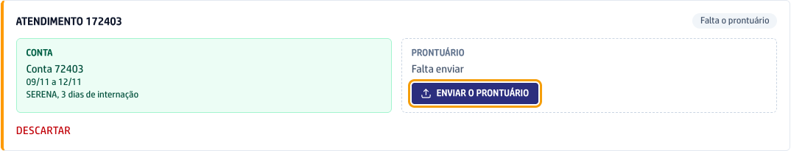
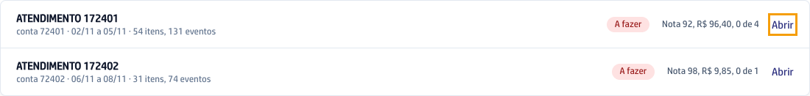
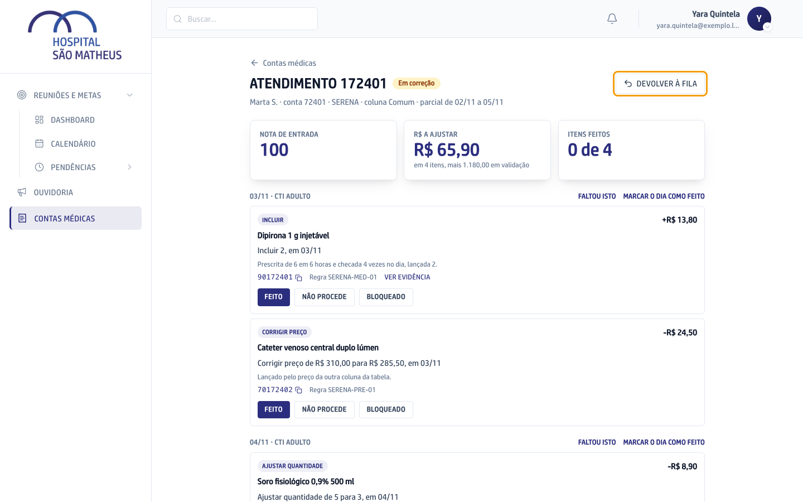
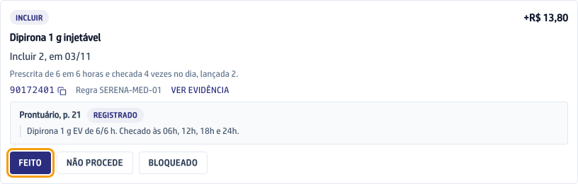
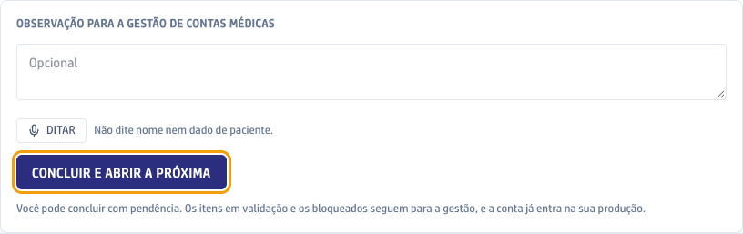
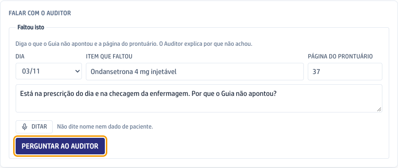

Aqui a conta do MV é conferida antes de ir para a operadora. Quem envia sobe o PDF da conta e o do prontuário. O app compara um com o outro, pelas regras da operadora, e monta o Guia: a lista do que corrigir no MV, dia a dia. A faturista pega a conta na Fila, corrige no MV e marca cada linha.

## O caminho de uma conta

Passe o mouse num passo para ver o detalhe, ou clique em **Percorrer** para andar um passo por vez.

```fluxograma
inicio envio 1,1: Enviar a conta e o prontuário | Quem envia arrasta para a tela os dois PDFs exportados do MV. O app lê o tipo e o atendimento dentro de cada arquivo.
decisao dois 2,1: Chegaram os dois arquivos?
passo falta 2,2: Mandar o arquivo que falta | O cartão fica em Meus envios com o quadrado tracejado do arquivo que falta e o botão para mandar só ele.
passo analise 3,1: O app analisa a conta | Ele lê a conta e o prontuário, confere com as regras da operadora e monta o Guia. Quem enviou acompanha em Meus envios.
decisao certo 4,1: A análise deu certo?
passo erro 4,2: Enviar de novo | O cartão mostra o erro, o botão Enviar de novo e o Copiar para a TI, que leva o código do erro para quem vai olhar.
passo fila 5,1: A conta entra na Fila | Com o Guia pronto, a conta vai para a Fila, que é a mesma para todas as faturistas, em ordem de envio.
passo pegar 6,1: A faturista pega a conta | Abrir o Guia de uma conta da Fila faz dela a dona. Se duas abrem juntas, só uma fica com a conta.
passo guia 7,1: Corrigir no MV pelo Guia | Cada linha diz o que corrigir. A faturista corrige no MV e marca Feito, Não procede ou Bloqueado. O que o Guia não apontou vai no Faltou isto.
fim concluida 8,1: Análise concluída | Concluir e abrir a próxima. A conta entra na produção da faturista, e o que ficou em validação segue para a gestão.

envio -> dois
dois -> analise: sim
dois -> falta: não
falta -> analise
analise -> certo
certo -> fila: sim
certo -> erro: não
erro -> analise
fila -> pegar
pegar -> guia
guia -> concluida
```

## Enviar uma conta

1. No menu da esquerda, clique em **Contas médicas**.
2. Exporte do MV o PDF da conta e o PDF do prontuário do atendimento.
3. Arraste os dois arquivos para o quadro **Arraste aqui a conta e o prontuário do MV**, ou clique em **Selecionar arquivos** e escolha os PDFs. Pode mandar vários atendimentos de uma vez, sem renomear: até 10 atendimentos e 30 arquivos por envio.



4. Logo abaixo, o quadro **Último envio** diz o que entrou de cada atendimento e o que foi recusado, com o motivo.
5. Acompanhe a conta na aba **Meus envios**. Cada atendimento vira um cartão com um quadrado para a Conta e outro para o Prontuário: verde o que chegou, tracejado o que falta.
6. Se faltou um arquivo, clique no botão do quadrado tracejado e mande só ele.



Quando a análise termina, o cartão sai de Meus envios e aparece o aviso de que o atendimento foi para a Fila. Se a análise deu erro, o cartão fica vermelho, com **Enviar de novo** e **Copiar para a TI**.

## Pegar uma conta da Fila

A Fila é a mesma para todas as faturistas e anda na ordem de envio, nunca pelo valor da conta.

1. Em Contas médicas, clique na aba **Fila**.
2. Na linha do atendimento, clique em **Abrir**. Comece pela primeira da lista.



3. O Guia da conta abre e, nesse clique, a conta passa a ser sua: sai da Fila e vai para a sua aba **Minhas**. No alto ficam o atendimento, o paciente, a conta, a operadora e o período, e logo abaixo os três números: **Nota de entrada**, **R$ a ajustar** e **Itens feitos**.



4. Se você não vai terminar a conta, clique em **Devolver à fila**, no alto do Guia. Ela volta para a Fila e as marcações que você já fez ficam.

## Analisar a conta no Guia

As linhas do Guia vêm agrupadas por dia e setor. Cada uma começa pelo que fazer no MV: **Incluir**, **Ajustar quantidade**, **Retirar** ou **Corrigir preço**.

1. Leia a linha: o item, a quantidade e a diferença em reais. Clique no código para copiar e colar no MV. **Ver evidência** mostra a página do prontuário e o trecho que justificam a linha.
2. Corrija no MV e marque a linha:
   - **Feito**, quando você corrigiu;
   - **Não procede**, quando a linha está errada. Escolha o motivo e clique em **Confirmar**;
   - **Bloqueado**, quando não dá para corrigir agora.



3. A linha marcada fica com a cor do que você escolheu. Se errou, clique em **Desfazer**. Quando corrigiu o dia inteiro, **Marcar o dia como feito** marca todas as linhas dele de uma vez.
4. A linha **Validar** não tem botão: o item já foi para a validação da gestão.
5. No fim da página, escreva, se quiser, a **Observação para a gestão de contas médicas**.
6. Clique em **Concluir e abrir a próxima**. A conta entra na sua produção e a próxima da Fila já abre. Dá para concluir com linha sem marcação: o app pergunta antes, e os itens em validação e os bloqueados seguem para a gestão.



## Pedir o que faltou

Use quando um item foi usado no atendimento, está no prontuário e o Guia não apontou.

1. No Guia, ao lado do dia, clique em **Faltou isto**. O quadro **Falar com o auditor**, no fim da página, já vem com esse dia escolhido.
2. Escreva o **Item que faltou** e a **Página do prontuário** onde ele aparece.
3. Se quiser, escreva a sua pergunta na mensagem para o auditor.
4. Clique em **Perguntar ao auditor**. Ele lê o dia e responde por que o Guia não achou o item e de onde veio a falha.



5. Quando a resposta diz que a falha é do sistema ou de uma página que não foi lida, aparece **Abrir o pedido para a Tecnologia**. Clique nele para mandar o caso para correção.
