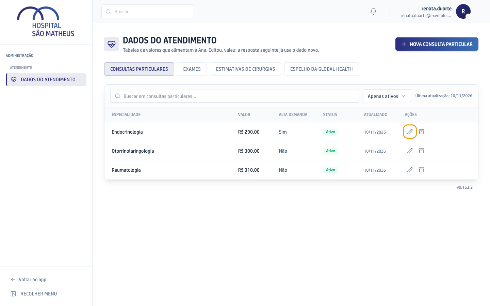
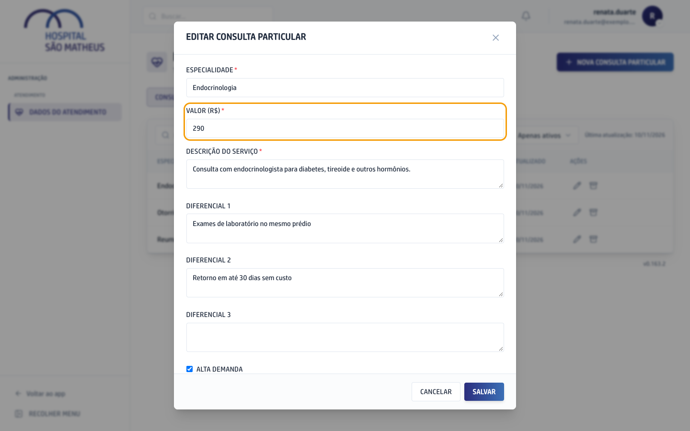
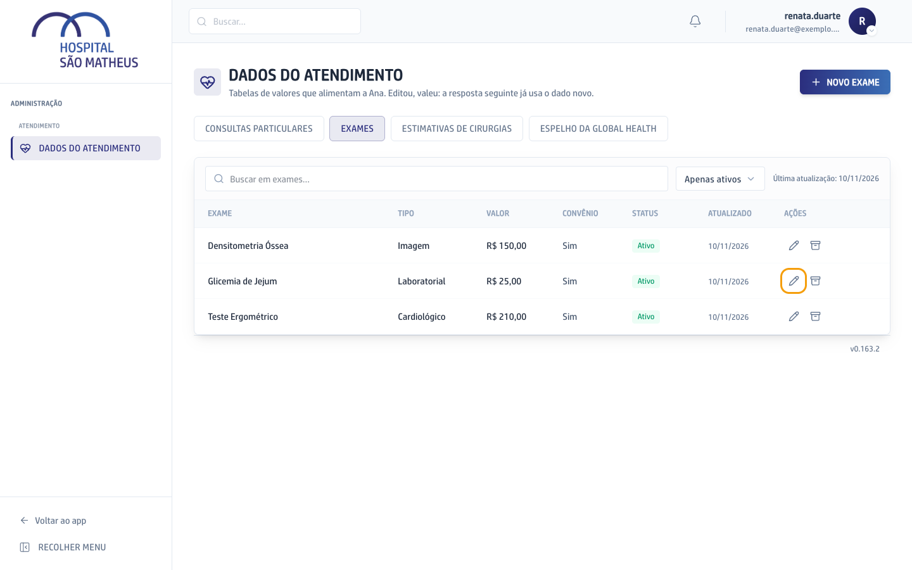
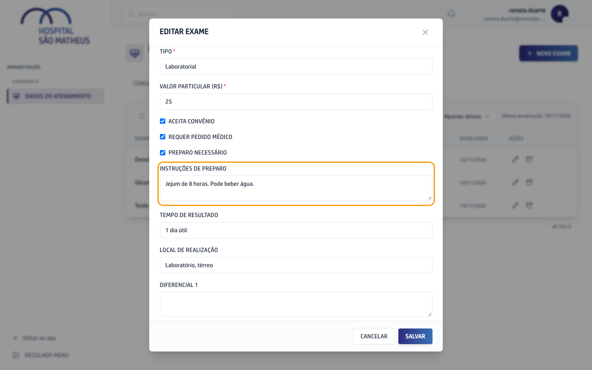
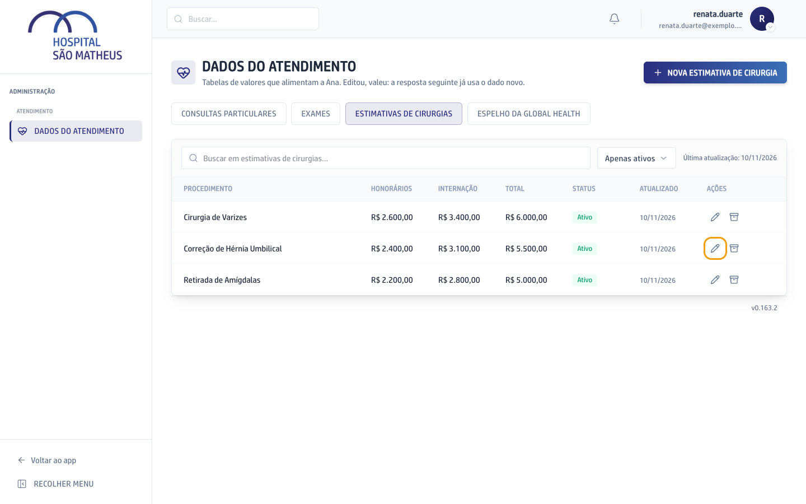
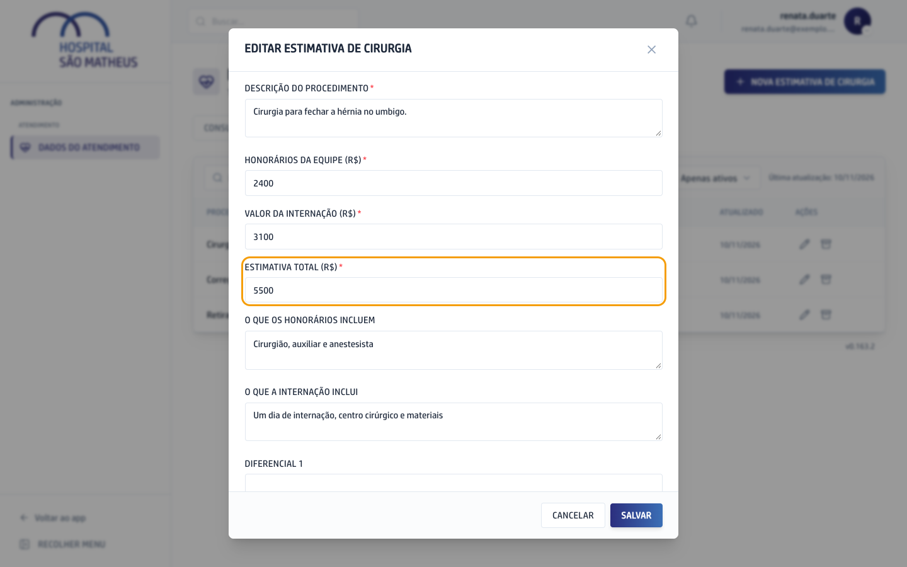

Aqui ficam as tabelas que a Ana consulta para responder os pacientes: o preço das consultas particulares, os exames com o preparo de cada um e a estimativa das cirurgias. A secretária e o Super admin editam. O facilitador só consulta, e para ele os botões de editar não aparecem.

O que muda numa tabela vale na hora. Não há botão de publicar nem espera: a próxima resposta da Ana já sai com o dado novo.

```fluxograma
inicio editar 1,1: Editar na tabela | Quem edita abre a linha pelo lápis, muda o valor e clica em Salvar.
passo salvo 2,1: Salvo na hora | A tabela guarda a mudança e a coluna Atualizado passa a mostrar a data de hoje.
passo pergunta 3,1: Paciente pergunta à Ana | Por exemplo, quanto custa uma consulta ou qual é o preparo de um exame.
passo consulta 4,1: Ana lê a tabela | A cada pergunta ela busca o dado direto daqui, sem cópia guardada.
decisao ativo 5,1: Registro ativo?
fim resposta 6,1: Ana responde com o dado novo | O preço, o preparo ou a estimativa que acabou de ser salvo.
passo fora 5,2: Fica fora da resposta | Registro desativado não chega à Ana. Para ele voltar, clique em Reativar na linha.
editar -> salvo
salvo -> pergunta
pergunta -> consulta
consulta -> ativo
ativo -> resposta: sim
ativo -> fora: não
```

## Mudar o preço de uma consulta particular

1. No menu da esquerda, clique em **Admin** e depois em **Dados do Atendimento**.
2. A tela abre na tabela **Consultas particulares**. Ache a especialidade na lista ou escreva o nome dela na busca.
3. Clique no lápis da linha da especialidade.



4. Troque o número em **Valor (R$)**. A descrição e os diferenciais também são lidos pela Ana, para explicar a consulta ao paciente.
5. Clique em **Salvar**. A mensagem "Registro atualizado" confirma a mudança.



Para tirar uma especialidade da resposta da Ana sem apagar nada, clique na caixa ao lado do lápis (**Desativar**). Ela continua na lista, em **Apenas desativados**, e volta com **Reativar**.

## Mudar o preparo de um exame

1. Em **Dados do Atendimento**, clique na aba **Exames**.
2. Clique no lápis da linha do exame.



3. Deixe marcado **Preparo necessário** e escreva em **Instruções de preparo** o que o paciente faz antes do exame, como o tempo de jejum.
4. Se precisar, ajuste também o **Tempo de resultado** e o **Local de realização**.
5. Clique em **Salvar**.



## Mudar a estimativa de uma cirurgia

1. Em **Dados do Atendimento**, clique na aba **Estimativas de cirurgias**.
2. Clique no lápis da linha do procedimento.



3. Ajuste **Honorários da equipe (R$)** e **Valor da internação (R$)**.
4. Escreva em **Estimativa total (R$)** a soma dos dois. A tela não faz a conta sozinha.
5. Confira o **Aviso obrigatório da Ana**. Ela repete esse texto sempre que fala da estimativa, para lembrar que o valor final só sai depois da avaliação médica. O campo não pode ficar em branco.
6. Clique em **Salvar**.


