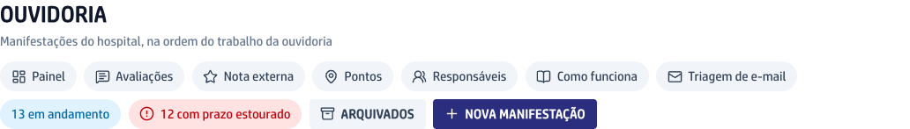
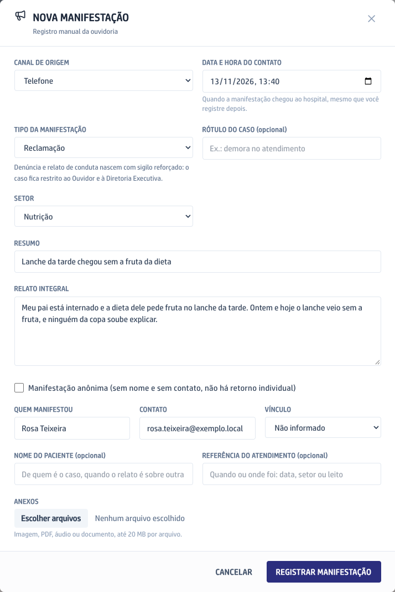
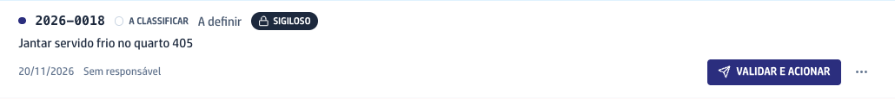
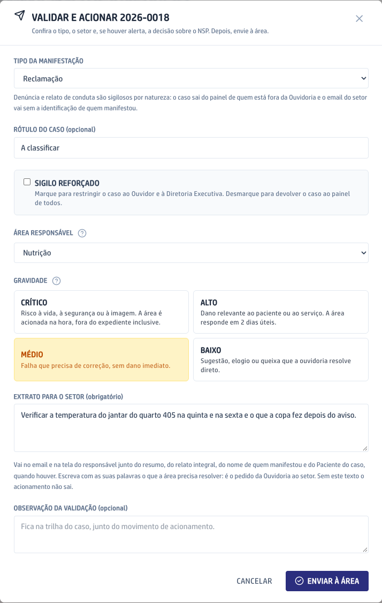
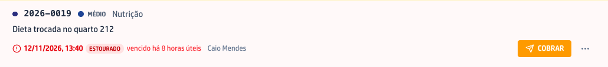
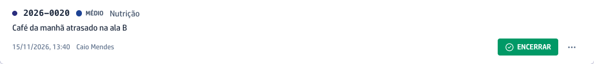
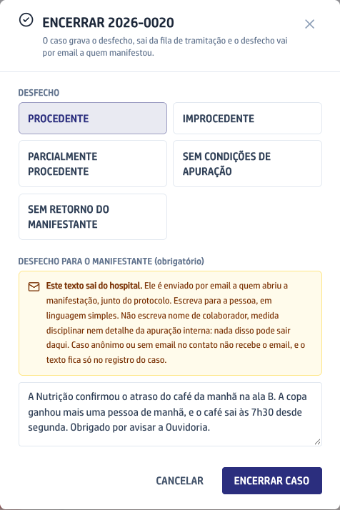

Aqui chegam as reclamações, sugestões, elogios e denúncias de pacientes, acompanhantes e colaboradores. A Ouvidoria confere cada caso, manda para o setor certo, cobra a resposta e devolve o desfecho a quem manifestou.

Quem não é da Ouvidoria vê só a lista dos casos, sem o relato. As tarefas abaixo são de quem tem o acesso de ouvidor ou da Diretoria Executiva.

## O caminho de uma manifestação

Passe o mouse num passo para ver o detalhe, ou clique em **Percorrer** para andar um passo por vez. Os prazos são os padrões da tabela da Diretoria, que pode mudá-los na tela **Prazos**. Eles correm de segunda a sexta, das 8h às 17h, sem feriados. Só o aviso de recebimento conta horas corridas.

```fluxograma
inicio chega 1,1: A manifestação chega | Pelo QR, pelo site, pela Ana, por e-mail ou pelo registro da Ouvidoria. Quem deixou contato recebe o aviso de recebimento em até 24 horas.
passo validar 2,1: Validar e acionar | A Ouvidoria confere o tipo, o setor e a gravidade e envia à área. Prazo para isso: 1 dia útil no caso médio, 4 horas úteis no alto e na hora no crítico.
passo area 3,1: A área responde | O responsável do setor recebe o e-mail e responde pelo link. Prazo: 4 dias úteis no caso médio, 2 dias úteis no alto e 4 horas úteis no crítico.
decisao prazo 4,1: Respondeu no prazo?
passo cobrar 4,2: Cobrar a área | O botão Cobrar manda o pedido de novo. Quando o prazo vence, o sistema também cobra sozinho e depois avisa o gestor da área e a Diretoria.
passo revisar 5,1: Revisar a resposta | A Ouvidoria lê o que a área respondeu e escreve o desfecho em linguagem simples.
fim encerrar 6,1: Encerrar com o manifestante | O desfecho vai por e-mail a quem manifestou. Prazo contado da chegada do caso: 7 dias úteis no caso médio, 5 no alto e 2 no baixo.

chega -> validar
validar -> area
area -> prazo
prazo -> revisar: sim
prazo -> cobrar: não
cobrar -> area
revisar -> encerrar
```

## Registrar uma manifestação

Use quando a pessoa reclama por telefone, no balcão, pelo Instagram ou pelo Reclame Aqui. O que chega pelo QR, pelo site e pela Ana já entra sozinho na lista.

1. No menu da esquerda, clique em **Ouvidoria**.
2. No alto da tela, clique em **Nova manifestação**.



3. Escolha o **Canal de origem** e confira a data e a hora em que a pessoa entrou em contato.
4. Escolha o **Tipo da manifestação** e o **Setor**. Denúncia e relato de conduta ficam restritos à Ouvidoria e à Diretoria Executiva.
5. Escreva o **Resumo** em uma linha e, no **Relato integral**, o que a pessoa contou, sem mudar as palavras dela.
6. Preencha **Quem manifestou** e o **Contato**, ou marque **Manifestação anônima**. Se o relato é sobre outra pessoa, preencha o nome do paciente.
7. Clique em **Registrar manifestação**. O caso entra na lista com um número de protocolo, para você passar à pessoa.



## Encaminhar ao setor

Todo caso novo fica no grupo **Em classificação** até a Ouvidoria conferir e mandar para a área, e nenhum setor recebe o caso antes disso.

1. Na lista, ache o caso e clique em **Validar e acionar**.



2. Confira o **Tipo da manifestação**. Se o caso não precisa de sigilo, desmarque **Sigilo reforçado**.
3. Escolha a **Área responsável**.
4. Escolha a **Gravidade**. É ela que decide o prazo que a área recebe.
5. Escreva o **Extrato para o setor**: com as suas palavras, o que a área precisa apurar e responder. Sem esse texto, o envio não sai.
6. Clique em **Enviar à área**. O responsável do setor recebe o e-mail com o caso e o prazo, e o caso passa para **Aguardando área**.



## Cobrar a resposta do setor

A data de cada caso fica vermelha quando o prazo da área venceu, com o tempo de atraso ao lado.

1. Na lista, ache o caso com o prazo em vermelho. O botão principal dele é **Cobrar**.
2. Clique em **Cobrar**. O pedido sai de novo para o responsável do setor, e a linha mostra para quem foi.



Você não precisa cobrar todo dia: quando o prazo vence, o sistema cobra o setor sozinho. Se o atraso continua, ele avisa o gestor da área e, depois, a Diretoria Executiva.

## Encerrar com o manifestante

Quando a área responde, o caso sobe para o bloco **Aguardando seu encerramento**, no alto da lista.

1. Para ler a resposta da área, clique no número do protocolo do caso.
2. De volta à lista, clique em **Encerrar** na linha do caso.



3. Escolha o **Desfecho**: procedente, improcedente, parcialmente procedente, sem condições de apuração ou sem retorno do manifestante.
4. Escreva o desfecho para quem manifestou, em linguagem simples. Esse texto sai do hospital: não escreva nome de colaborador nem detalhe da apuração interna.
5. Clique em **Encerrar caso**. Quem deixou e-mail recebe o desfecho junto do protocolo.


