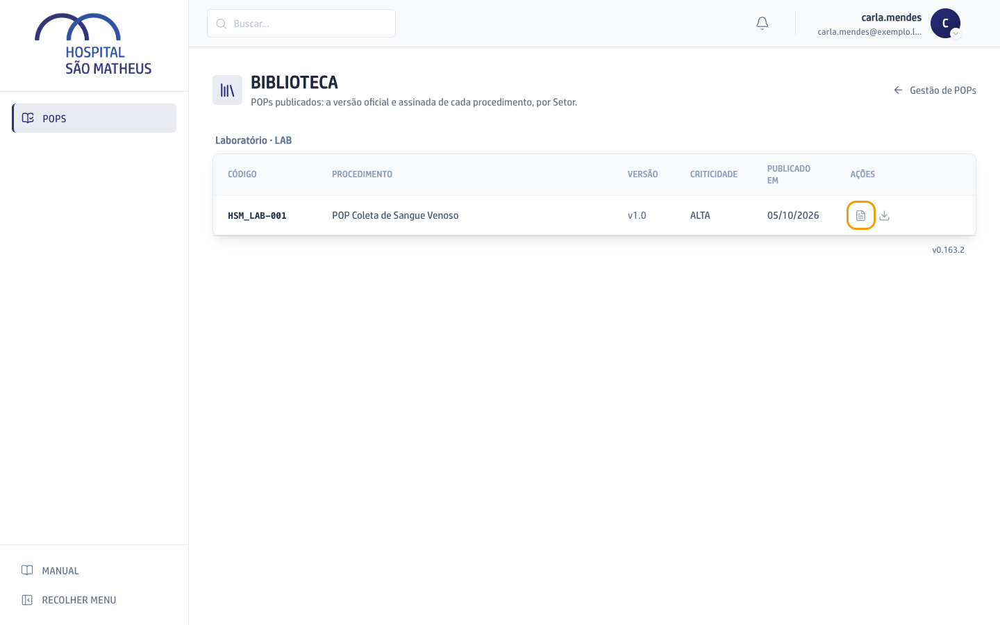
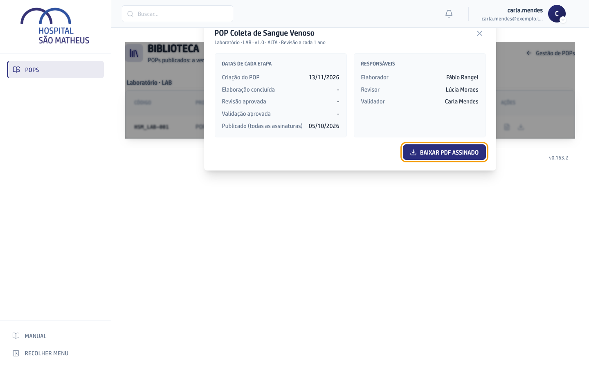
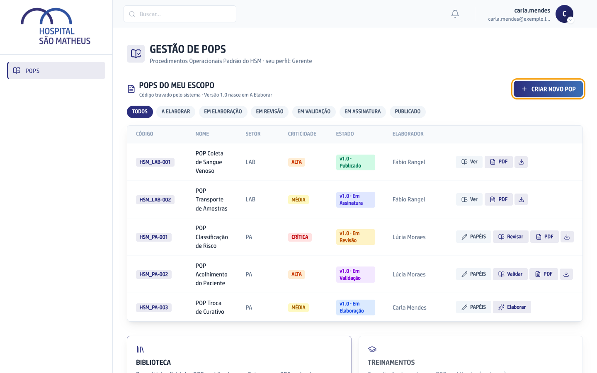
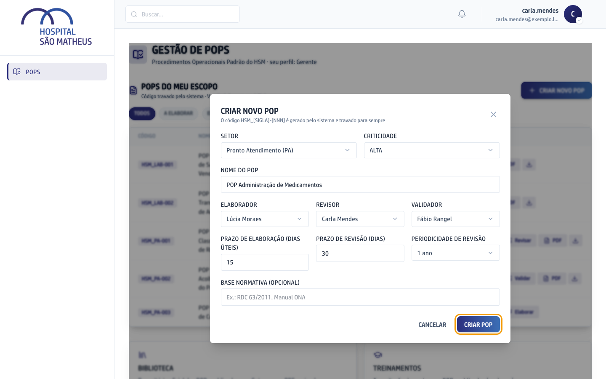
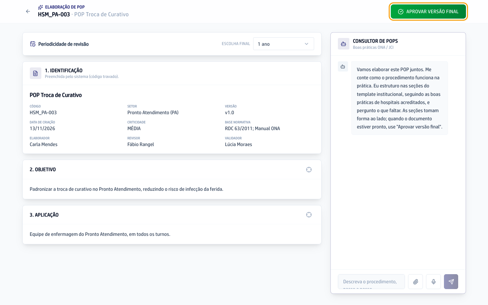
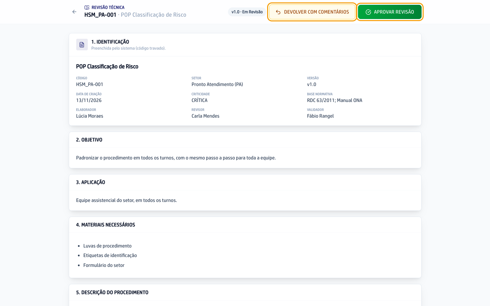
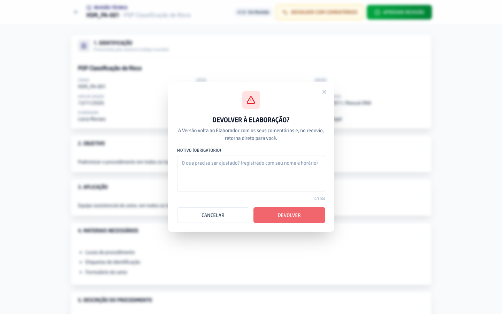
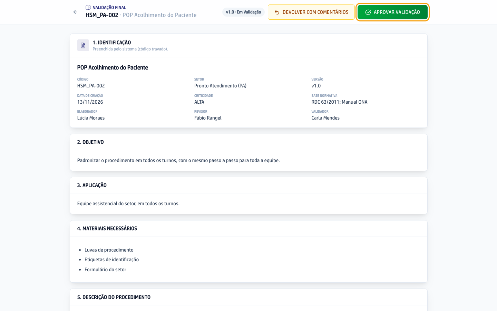
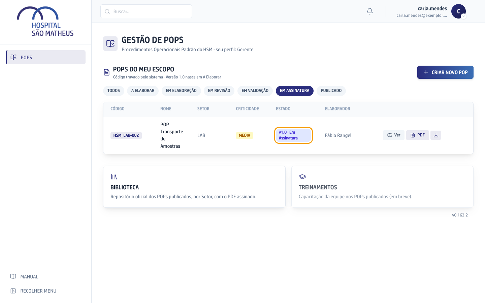

O POP (Procedimento Operacional Padrão) diz como um procedimento do hospital deve ser feito, sempre do mesmo jeito. Aqui o hospital escreve cada POP, passa por revisão e validação, colhe as assinaturas e publica. Na criação, cada POP ganha três pessoas: quem elabora, quem revisa e quem valida.

O caminho de um POP, do rascunho até a versão publicada:

```fluxograma
inicio criar 1,1: Criar o POP | Quem cria escolhe o setor e as três pessoas. A versão nasce como rascunho, em A elaborar.
passo elaborar 2,1: Elaborar | Quem elabora escreve o POP com o Consultor de POPs e aprova a versão final.
decisao revisao 3,1: Revisão aprovada? | Quem revisa lê a versão inteira. Se faltar algo, devolve com comentários, e o POP volta para quem elaborou.
decisao validacao 4,1: Validação aprovada? | Quem valida faz a última leitura antes das assinaturas e também pode devolver com comentários.
passo assinar 5,1: Assinar | As três pessoas assinam o documento digitalmente, pelo e-mail.
fim publicada 6,1: Versão publicada | O POP entra na Biblioteca, com o PDF assinado.
criar -> elaborar
elaborar -> revisao
revisao -> validacao: sim
revisao -> elaborar: não
validacao -> assinar: sim
validacao -> elaborar: não
assinar -> publicada
```

## Achar um POP publicado

1. No menu da esquerda, clique em **POPs**.
2. Desça a tela até o cartão **Biblioteca** e clique nele.
3. A Biblioteca mostra os POPs publicados, separados por setor, com a versão e a data em que cada um foi publicado.
4. Para ver as datas de cada etapa e quem participou, clique no ícone da **Ficha do POP**, na linha dele.



5. Na Ficha, clique em **Baixar PDF assinado** para ter o documento oficial.



## Criar um POP

1. No menu da esquerda, clique em **POPs**.
2. Clique em **Criar novo POP**.



3. Escolha o setor e a criticidade e escreva o nome do POP.
4. Escolha quem elabora, quem revisa e quem valida.
5. Confira os prazos e escolha de quanto em quanto tempo o POP deve ser revisto. A base normativa é opcional.
6. Clique em **Criar POP**. O código do POP (por exemplo, HSM_PA-003) sai do sistema, com a sigla do setor, e ninguém consegue mudá-lo depois.



## Escrever o POP com o Consultor

1. Na lista de POPs, clique em **Elaborar** na linha do POP. O botão aparece só para quem elabora.
2. À direita, o Consultor de POPs pergunta como o procedimento funciona na prática. Responda por escrito ou pelo microfone. Se já existe um POP antigo, uma norma ou o modelo do hospital, anexe pelo clipe, e o Consultor escreve a partir desse material.
3. As seções do POP aparecem à esquerda enquanto a conversa anda. Para corrigir uma seção, clique no alvo ao lado do título dela e diga o que mudar.
4. No alto, confira a periodicidade de revisão.
5. Com o documento pronto, clique em **Aprovar versão final**. O POP segue para quem revisa.



## Revisar um POP

1. Na lista de POPs, clique em **Revisar** na linha do POP.
2. Leia a versão inteira.
3. Se estiver certa, clique em **Aprovar revisão** e confirme. O POP segue para quem valida.



4. Se faltar alguma coisa, clique em **Devolver com comentários**, escreva o que precisa mudar e clique em **Devolver**. O POP volta para quem elaborou, e depois do ajuste ele volta direto para você.



## Publicar a versão nova

1. Quem valida clica em **Validar** na linha do POP, na lista de POPs.
2. Leia a versão. Se precisar de ajuste, use **Devolver com comentários**, do mesmo jeito da revisão.
3. Se estiver tudo certo, clique em **Aprovar validação** e confirme.



4. O POP passa para **Em Assinatura**, e as três pessoas recebem por e-mail o pedido de assinatura digital.
5. Quando a última pessoa assina, a versão é publicada sozinha e entra na Biblioteca.


